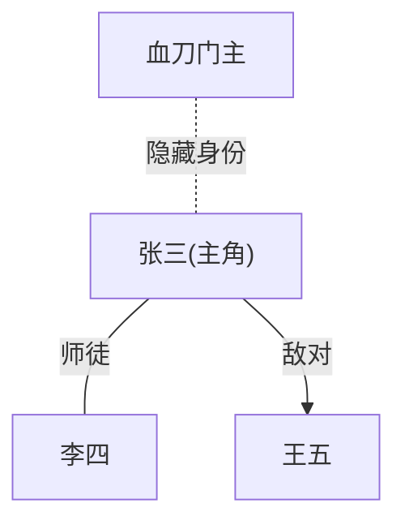

# 输出文档模板(novel-analyze)

五份文档统一放 `<书名>-analysis/` 下。以下模板按需增减条目,小节顺序保持;`<>` 为待填内容。

## 01-大纲.md

```markdown
# 《书名》大纲

> 原稿:<路径> · 总字数:约 X 万 · 分析日期:YYYY-MM-DD

## 全书结构
<卷/部/幕划分,每卷一句话定位;若单卷,说明三幕/起承转合切分点>

## 情节主线
<主线一句话;开头钩子、中段转折、高潮、结局>

## 逐章梗概
| 章节 | 一句话梗概 | 核心冲突 | 对主线的推进 |
| --- | --- | --- | --- |

## 未回收伏笔 / 疑点
- <伏笔 → 出现章节 → 是否回收>
```

## 02-简介与世界观.md

```markdown
# 《书名》简介与世界观

## 一句话简介
<25 字以内>

## 简介(约 200 字)
<可当投稿/封底简介,不剧透结局>

## 题材标签
<如:玄幻、群像、升级流、权谋>

## 世界观
### 时代与背景
### 地理格局
<主要区域及其特征>
### 势力与组织
<组织 → 立场 → 实力 → 关键人物>
### 核心规则体系
<力量/科技/魔法体系、等级、代价>
### 核心矛盾与主题
```

## 03-人物关系.md

```markdown
# 《书名》人物关系

## 人物速览表
| 姓名 | 明面身份 | 隐藏身份 | 阵营 | 重要度 |
| --- | --- | --- | --- | --- |

## 关系图



## 多重身份
<每个身兼多重身份的人物单独一个 mermaid 子图:中心人物节点用虚线连到各身份节点,标注暴露章节>

## 阵营划分
<阵营 → 成员 → 立场关系>

## 关系明细表
| 人物 A | 关系 | 人物 B | 说明 | 证据章节 |
| --- | --- | --- | --- | --- |
```

## 04-时间线与人物弧线.md

```markdown
# 时间线 · 空间线 · 人物弧线

## 主时间线
| 序 | 故事内时间 | 事件 | 章节 | 影响/后果 |
| --- | --- | --- | --- | --- |

## 空间线
<地点迁移链:A地 →(事件)→ B地 →(事件)→ C地;每段注明章节>

## 人物弧线
### 人物名
| 阶段 | 遭遇 | 做了什么 | 导致什么 | 人物的变化 |
| --- | --- | --- | --- | --- |

(每个主要人物一节;变化包含性格、立场、能力、关系四维度)
```

## 05-设定集.md

```markdown
# 《书名》设定集

## 力量 / 能力体系
<等级划分、晋升条件、代价与限制>

## 组织与势力
| 名称 | 立场 | 实力 | 关键人物 | 备注 |
| --- | --- | --- | --- | --- |

## 地理与场景
<地点 → 特征 → 发生的关键剧情>

## 物品 / 道具
<名称 → 能力/意义 → 持有者 → 相关章节>

## 规则与禁忌
<世界运行的硬规则、禁区、代价>

## 专有名词表
| 术语 | 解释 | 首次出现章节 |
| --- | --- | --- |
```
