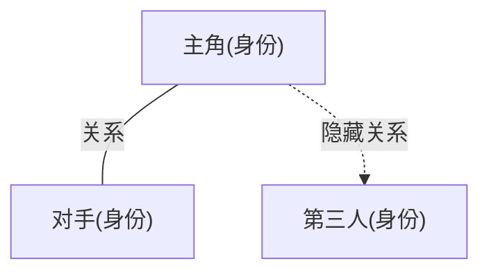

# 大纲产出模板(novel-outline)

四份文档统一放 `<书名>-outline/` 下,另加 `_progress.md`。`<>` 为待填;`> 📖 教学注释:` 引用块为必写内容(面向小白的讲解),用户开写正文后可整体删去。

## 01-灵感与设定.md

```markdown
# 《书名》灵感与设定

> 📖 教学注释:这是全书的"户口本"。写正文卡住时回来对三样:一句话简介(没写偏没偏)、人物小传(人设崩没崩)、世界观(设定打架没)。

## 一句话简介
<≤25 字:谁 + 想要什么 + 最大障碍>

## 简介(约 200 字)
<封底简介:亮开局钩子与看点,不剧透结局>

## 题材标签
<3-5 个>

## 爽点与看点清单
| 爽点 | 说明 | 密度 |

## 世界观
### 时代与背景
### 地理格局
### 势力与组织
| 势力 | 立场 | 实力 | 关键人物 |
### 规则体系
<无超自然就写世俗规矩与制度;有就写等级、晋升、代价;顺带登记关键道具与代号>
### 核心矛盾与主题

## 人物小传
> 📖 教学注释:四件套 = 欲望/恐惧/秘密/弧线;"暗线身份"列写他真正在棋盘上的位置。每写一场戏,问一遍:在场每个人分别被什么推着、拦着?
复杂度基线:双重身份 ≥3 组、隐藏关系 ≥3 组、镜像人物 ≥2 组、血缘暗雷 ≥1 组;反派分层(明面反派 → 白手套 → 幕后棋手)。
| 姓名 | 明面身份 | 暗线身份 | 欲望 | 恐惧 | 秘密 | 弧线一句话 |
<主角 → 对手 → 幕后棋手 → 关键配角;戏份越多的人四件套必须越全>

## 人物关系图
> 📖 教学注释:实线=明面关系,虚线=隐藏关系。关系变了回来改图,防"关系漂移"。


```

## 02-主线大纲.md

```markdown
# 《书名》主线大纲

> 📖 教学注释:双线不是主线+支线——明线给爽,暗线给"回头重看一遍"的回味。每卷写清"起点状态 → 终点状态",卷末人物和局势必须真的变了;中点是全书腰眼,暗线此段必须揭一层。

## 明线与暗线
| 线 | 内容 | 读者视角 | 功能 |
| 明线 | <爽点线> | 看得见 | 爽点与情感 |
| 暗线 | <真相线> | 逐步揭盅 | 反转与回味 |

## 暗线层级反转
| 层 | 内容 | 揭盅章节 |

## 对表点(两线交汇章节)
| 章节 | 明线事件 | 暗线动态 |

## 全书结构
| 卷 | 章节 | 时间跨度 | 起点状态 | 终点状态 | 明线定位 | 暗线定位 |

## 明线事件链
> 📖 教学注释:必须"因为 A 所以 B",不能"然后 A 然后 B"。新情节接不上链子的,砍。
<箭头链,伏笔以 F## 标注>

## 暗线事件链
<幕后棋手的布局 → 与明线合流 → 收网 → 摊牌>

## 感情线节奏点(或副线节奏点)
| 拍 | 内容 | 章节 |

## 成长线节奏点(主角弧线落点)
<阶段 → 章节>

## 高潮与结局
<中点高潮 / 终局高潮 / 结局与尾声>
```

## 03-逐章大纲.md

```markdown
# 《书名》逐章大纲

> 📖 教学注释:这就是你的"日更地图"。每天只细化当天要写的那一行:行内梗概扩成 5-8 个场景节拍,再写正文。每章必填冲突与钩子,缺一项就重写本章。

## 逐章大纲
### 卷一 <卷名>(第 1-N 章)
| 章节 | 章名 | 一句话梗概 | 核心冲突 | 爽点/看点 | 章末钩子 | 暗线动态 |
| --- | --- | --- | --- | --- | --- | --- |
<暗线动态列:一句话,写"露一寸/静默/对表点"级别;两线必须按 02 的对表点合流>

### 卷二 …
```

## 04-伏笔与自检.md

```markdown
# 《书名》伏笔与自检

> 📖 教学注释:伏笔编号管理,埋的时候就想好哪章收;伏笔须覆盖明暗两线——暗线每层反转至少一条专属伏笔。写作时人名地名一律从统一名表复制粘贴,防错字防改名。

## 伏笔表
| 编号 | 伏笔内容 | 埋设章节 | 回收章节 | 作用 |
| --- | --- | --- | --- | --- |
| F01 | … | … | … | … |

## 统一名表
| 定稿名 | 类别 | 曾用名/别名 | 说明 |
| --- | --- | --- | --- |

## 自检十问
1. 第 1 章出事了吗?
2. 一句话简介现在还成立吗?
3. 每章都有冲突和钩子吗?
4. 反派降智了吗?
5. 金手指过大吗(能力付代价了吗)?
6. 伏笔都排好回收章节了吗?
7. 感情线(副线)靠巧合吗?
8. 中段有灌水风险吗(事件因果相连吗)?
9. 视角漂移了吗?
10. 结局靠巧合吗?
<逐问作答,答不上来的回去改大纲>
```

## _progress.md

```markdown
# 《书名》大纲进度
- [ ] 输入确认:题材=<>;篇幅=<>;视角=<>;结局=<>
- [ ] 定型:一句话简介 / 标签 / 爽点清单
- [ ] 01-灵感与设定.md
- [ ] 02-主线大纲.md
- [ ] 03-逐章大纲.md
- [ ] 04-伏笔与自检.md
- [ ] verify-outline 校验通过(warnings=0 或已说明)
```