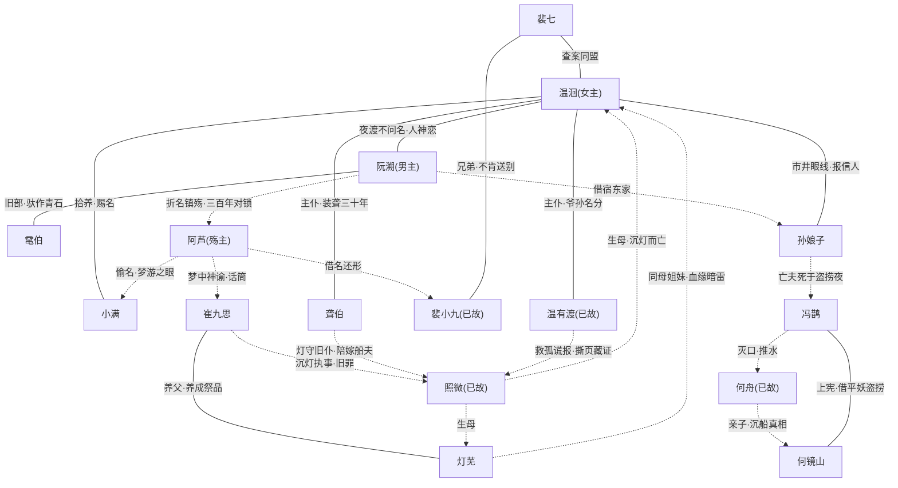

# 《夜渡不问名》灵感与设定(明暗双线版)

> 📖 **教学注释**:本文件是全书的"户口本"。双线看「明线与暗线」小节;人设看"暗线身份"列——**每个人明面上的身份,和他真正在棋盘上的位置,往往不是一回事**。写正文卡住时回来对三样:一句话简介(没写偏没偏)、人物小传(人设崩没崩)、世界观(设定打架没)。

## 一句话简介

守渡女与失名河伯,血灯照冤,渡人亦渡己。

> 📖 教学注释:25 字内说清"谁 + 想要什么 + 最大障碍"。这句话是全书靶心,日后每个情节都问一句:"它在帮主角靠近这句话吗?"接不上的,砍。暗线不改变这句话,只给它加厚。

## 简介(约 200 字)

问津渡有条祖规:夜渡不问名。
温洄守了这条渡口十九年,直到那个雨夜,三年前溺死的货郎敲响了船板——镇上人都说他"没死",可他的名字,全镇没一个人记得起来了。
同一个雨夜,借宿回春堂的郎中阮溯隔水而立:温和,干净,身上带着化不开的水汽,每月十五准时消失一夜。
她说:渡你,不问名。他说:我的名字,在这条河里。
她以血点灯,照见河底灯市、沉船与亡魂遗言;他借水行舟,渡她过一程又一程黄泉浪。
灯点得越多,河把她的名字记得越牢——直到她发现,自己的名字,也早被人从命格里偷走过一次。
渡人者,谁渡之?

## 题材标签

古代言情 / 志怪 / 聊斋风 / 人神恋 / 单元探案 / 明暗双线 / 群像 / HE

## 明线与暗线

> 📖 **教学注释**:双线不是"主线+支线"。明线给读者爽,暗线给读者"回头重看一遍"的回味——每层暗线揭开,前文所有细节换一种读法。纪律:**暗线每 3-5 章必须露一寸,不露等于没有;两线必须按"对表点"合流。**

| 线 | 内容 | 读者视角 | 功能 |
| --- | --- | --- | --- |
| 明线(灯线) | 回游死人+丢名失踪连环案:守渡女以血点灯照冤,与神秘郎中联手查案,直至河灯节万灯祭决战 | 看得见的"破案+发糖+志怪奇观" | 爽点与情感 |
| 暗线(水线) | "名的债"三条拧成一股:殇主三百年抹名之怨;河伯失名之谜;女主灯守身世(同母妹妹+生母沉灯旧案) | 逐步揭盅的真相 | 反转与回味 |

**暗线三层反转**:
1. 一层(第 22 章揭):回游的不是人,是"殇"借亡者之名还形;失踪者是被偷了名字——案子从"闹鬼"变"偷名"。
2. 二层(第 30-31 章揭):伤河脉的是人不是妖——巡检借"平妖"盗捞沉船,香首借"河怒"敛财办祭;沉灯旧案牵出生母之死。
3. 三层(第 41-44、47 章揭):女主身世全揭(灯守遗孤/同母妹妹灯芜/万灯祭是殇主的局中局)+殇主来历(三百年前被全镇抹名的"河伯妇"阿芦)——神与殇同源,守与怨分岔。

## 爽点与看点清单

> 📖 教学注释:爽点是读者往下翻的理由。逐章大纲**每章必须至少挂一个**;本章没有爽点,就重写本章。

| 爽点 | 说明 | 密度 |
| --- | --- | --- |
| 引灯照真 | 血点河灯:照妖形、照遗言、照河底 | 每卷必用,寿债代价随用随涨 |
| 借水行舟 | "郎中"实为河伯,关键时刻顺水推舟式出手 | 每卷 2-3 次 |
| 规矩反杀 | 祖规三律皆是伏笔,破局全靠"守规矩的人会解规矩" | 大节点 |
| 还名起名 | 为无名者还名、给无家者起名——志怪式浪漫 | 情感节点 |
| 水下奇观 | 河底灯市、沉船开舱、殇集、十五潮 | 每卷 1-2 场 |
| 双向奔赴 | 溯洄从之:人神恋的名与命 | 主线 |

## 世界观

### 时代与背景

架空大宁朝,南方水乡**枕水镇**,临**青波江**,镇口野渡**问津渡**,温家五代守渡,渡船名"青雀"。三百年前大水,镇民以"嫁河伯"为名沉了渔家女**阿芦**("河伯妇"祭);水不退,怨聚成殇;年轻的河伯**阮溯**接任,折自己真名为钉镇住河眼——自此失名,借人身行走,每月十五沉河心以神血喂灯续封。**渡口祖规"夜渡不问名"**,就是当年为护他残余神格所立(渡口不呼神名,殇便寻不到他)。
十九年前枯水,河眼松动,庙方重启"河灯娘娘祭"(俗称**万灯祭**),沉"灯女"**照微**续灯——守渡长**温有渡**救之不及,只捞起襁褓,谎报为孙女养大,即温洄;他拼死谏废活人祭,并撕去渡人簿十九年前一页藏证。十三年前,巡检**何镜山**之子何舟溺亡;香首**崔九思**发迹。如今河眼又松,"回游的死人"开始敲船——所有的债,一起到期了。

### 地理格局

- **枕水镇**:青波江北岸,河埠街(回春堂、珠行)、灯市街、庙前街三条主街。
- **问津渡**:镇口野渡,温家茶棚+渡船"青雀";水底一块"大青石"(实为老鼋鼋伯)。
- **河神庙(青波君祠)**:庙前**万灯台**、**无字碑**(碑面被磨平的旧碑)。
- **河底**:灯市(亡魂集市)、沉船"浮金号"、河眼(河心漩涡之下)。

### 势力与组织

| 势力 | 立场 | 实力 | 关键人物 |
| --- | --- | --- | --- |
| 问津渡温家 | 守渡人,祖规护渡 | 渡船"青雀"+"渡人簿"记五代渡客 | 温洄、聋伯(哑仆) |
| 河神庙(崔氏香火) | 明面反派据点 | 敛财、办祭、动员镇民 | 崔九思、灯芜(养女"圣女") |
| 巡江河泊所 | 官面,白手套 | 借"平妖"盗捞沉船 | 何镜山、裴七(良知线) |
| 灯守一族(残) | 灯芯血脉 | 血可点河灯;祭废后散落 | 温洄、灯芜、照微(已故)、聋伯(旧仆) |
| 水府旧部 | 河伯旧属 | 老鼋驮船五百年 | 鼋伯(明面是渡口大青石) |
| 殇(无名者) | 幕后 | 借名还形,偷名摄魂 | 殇主阿芦(无字碑之主) |
| 归灯局(卷四新设) | 官办归名机构 | 专管亡者归名、送别 | 何镜山(首任局正) |

### 规则体系(志怪法则)

> 📖 教学注释:志怪的世界观就是"规矩+代价"。每条规矩都要在剧情里被用到至少一次,每份能力都要有代价——这是本书的"账",乱开金手指读者一眼看穿。

- **神以名立**:神有真名则有神格;名被折、被夺、被抹,神格即散。呼名即唤神——"夜渡不问名"由此而来。
- **河眼**:河心漩涡之下通"彼岸水",怨气之门;以河灯镇之,灯芯以灯守之血最固。
- **灯守之血**:血点河灯可"照真"(照妖形、照亡者遗言、照河底);记忆与名字写在灯上可唤回亡者记忆,称**记忆灯**;代价:每点一灯,河记其名一分——被河记住名字的人,寿数入河账,死后不得轮回,留在河里"当灯芯"。
- **回游与十五潮**:十五潮夜,执念深的溺亡者可"回游"还形;但殇会借亡者之名还形——辨真伪:回游者不记得自己怎么死的(殇不知死,它只借名)。
- **祖规三律**:夜渡不问名(护神)/不渡棺(渡口不载归人)/过河不回头(回头见"故人")。三条规矩各有来历,皆为伏笔。
- **蚌壳镜**:灯守信物,一对双半;合璧可照"真形"与旧影(照不见灯守自己)。温家半枚+灯芜半枚=照微遗物所拆。
- **渡人簿**:温家五代渡客名录;撕去的第十九年前一页,藏着照微案。灯守另有失传的**引灯谣**,唱全可引灯归名。

### 核心矛盾与主题

- 明线矛盾:回游死人连环案 vs 亡者不得安、生者不敢问。
- 暗线矛盾:"名的债"——被抹名者的怨 vs 守名者的义;神与殇同源,守与怨分岔。
- 主题:人这一生,是被记得,还是被忘记?**名字,是爱最短的写法。渡人者,谁渡之——相互渡。**

## 人物小传

> 📖 **教学注释**:四件套 = 欲望(想要什么)/ 恐惧(怕失去什么)/ 秘密(藏什么)/ 弧线(从头到尾变了吗);"暗线身份"列写他真正在棋盘上的位置。反派不是"坏",是**欲望与主角相撞**。每写一场戏问一遍:在场每个人分别被什么推着、拦着?

**人物网复杂度自查**:双重身份 5 组(阮溯/温洄/崔九思/何镜山/小满)✓;隐藏关系 ≥3 组(姐妹血缘、聋伯旧仆、裴七藏弟、小满之眼)✓;镜像人物 ≥2 组(失名之神 vs 被抹名之殇:阮溯 vs 阿芦;同血不同命:温洄 vs 灯芜;不肯送别 vs 学会送别:何镜山 vs 裴七)✓;血缘暗雷 ≥1 组(温洄-灯芜同母姐妹;崔九思是沉生母的执事)✓。

| 姓名 | 明面身份 | 暗线身份 | 欲望 | 恐惧 | 秘密 | 弧线一句话 |
| --- | --- | --- | --- | --- | --- | --- |
| 温洄 | 问津渡守渡人、茶棚老板娘 | 灯守遗孤,"灯芯"之体;河眼之钥 | 查清回游死人案,保渡口保全镇 | 血点灯折寿;更怕自己也是"祭品命" | 爷爷遗半枚蚌壳镜;她的血能点灯,每点一盏河记她名一分 | 从守规矩的人,长成写规矩的人 |
| 阮溯 | 游方郎中(初见自报"溯洄的溯"),借宿回春堂 | 青波江河伯,真名折作镇河之钉 | 河眼开前守住封印(或寻回真名) | 无名之神的下场:被河彻底遗忘 | 每月十五沉河心以神血喂灯;三百年前是他折名镇了阿芦 | 从"守河不守人"的孤神,到守一个人、甘愿成人 |
| 阿芦 | 无(常借回游尸还形) | 三百年前被沉河的"河伯妇",无字碑之主,殇之首 | 讨回名字,让全镇"下来作伴" | 名字再没人记得 | 她原是渡魂的善灵,被抹名后怨聚成殇 | 从怨的聚合,到被还名一瞬怨解,复任"渡魂" |
| 崔九思 | 河神庙香首,慈眉善目 | 十九年前沉灯执事;殇主"梦中神谕"的话筒 | 香火钱与"神谕"许的长生牌位 | 沉灯旧案发 | 沉照微那夜,他看见她怀里襁褓,仍闭了眼 | 从神棍到崩溃供旧案,疯守无字碑余生 |
| 何镜山 | 巡江河泊所巡检,"平妖能吏" | 借平妖盗捞沉船;丧子之父 | 找回儿子(或儿子遗物) | 儿子"回游"却被当妖戮 | 早查到沉船有灭口痕迹,为掩盖失职压下不报 | 从执念成魔,到知真相后辞官创归灯局 |
| 裴七 | 县衙捕头,查失踪案 | 私藏弟弟"回游尸"于城外破庙三年 | 弟弟能"活"一天是一天 | 上面发现,弟弟被当妖烧掉 | 他知道弟弟是殇披形,仍夜夜送饭 | 从不肯送别,到亲手为弟弟点归灯 |
| 灯芜 | 河神庙"圣女",本届"河灯娘娘"人选 | 温洄同母妹;被崔氏养成祭品 | 活;被当"人"看 | 十五夜的祭台 | 另半枚蚌壳镜贴身戴;把情报绣进嫁衣边角 | 从认命的祭品,到亲手掀了祭台 |
| 聋伯 | 渡口哑仆,撑旧渡 | 灯守族旧仆,照微陪嫁船夫,装聋三十年 | 护住照微骨血 | 旧事连累小姐 | 他认得蚌壳镜,记得沉灯夜全貌 | 从装聋,到开口第一句唱出照微之名 |
| 小满 | 渡口捡的孤儿,温洄跟班 | 第一个"被偷名字"的孩子,殇主留在人间的眼(不自知,梦游传讯) | 有个名字,有个家 | 被送走 | 户籍上他的名字是一团墨渍 | 从无名棋子,到被赐名收编,反成破局奇兵 |
| 鼋伯 | 渡口水底"大青石" | 河伯旧部老鼋,驮船镇水五百年;河底灯市的摆渡老人 | 老爷子(河伯)平安 | 河眼开 | 五百年没说过人话,只会驮船与点头 | 忠仆,终局驮万灯归名 |
| 照微 | (已故)十九年前的"灯女" | 灯守末代长女,温洄灯芜生母 | (生前)带女儿逃出祭典 | 女儿重蹈覆辙 | 沉河前把蚌壳镜拆半,半枚塞进襁褓;留血书 | 母线锚点,身世谜核心 |
| 温有渡 | (已故)守渡长温老爹 | 照微案的知情者与赎罪者 | (生前)废祭护孤 | 祭典重启 | 救孤谎报为孙女;撕渡人簿一页藏证;字条"洄儿血贵,莫点灯" | 旧罪的赎与护,三代托付的起点 |
| 孙娘子 | 回春堂掌柜,阮溯借宿东家 | 镇上市井眼线;亡夫死于十三年前"怪船夜" | 药铺太平 | 丢名传上自己家 | 私藏丈夫留下的"怪船日志" | 小人物的胆,翻案最后一枚钉 |
| 何舟 | (已故)巡检何镜山之子 | 第一个发现浮金号的孩子,被灭口伪装溺亡 | — | — | 死前把一枚金灯穗塞进河蚌 | 二层真相钥匙,父亲执念的解药 |
| 冯鹊 | 珠行把头 | 十三年前灭口执行者;浮金号盗捞操盘 | 船上前朝金灯 | 旧案发 | 何舟是他推的水;他瞒下真相继续领巡检的工钱 | 明面反派打手,被亡魂"接"走 |
| 裴小九 | (已故)三年前溺亡的渔家子 | 殇披形,借他名"回游" | (残念)哥别难过 | 被当妖烧掉 | 他本不记得怎么死的,是裴七的执念把他"喂"成了似人的殇 | 不肯送别=困住亡者;他自己求哥哥送他走 |

## 人物关系图

> 📖 **教学注释**:实线=明面关系,虚线=隐藏关系。任何人关系发生变化,回来改图,防"关系漂移"。这张图上虚线越多,暗线越厚——但每条虚线都必须在逐章大纲里有"露一寸"的章节。

