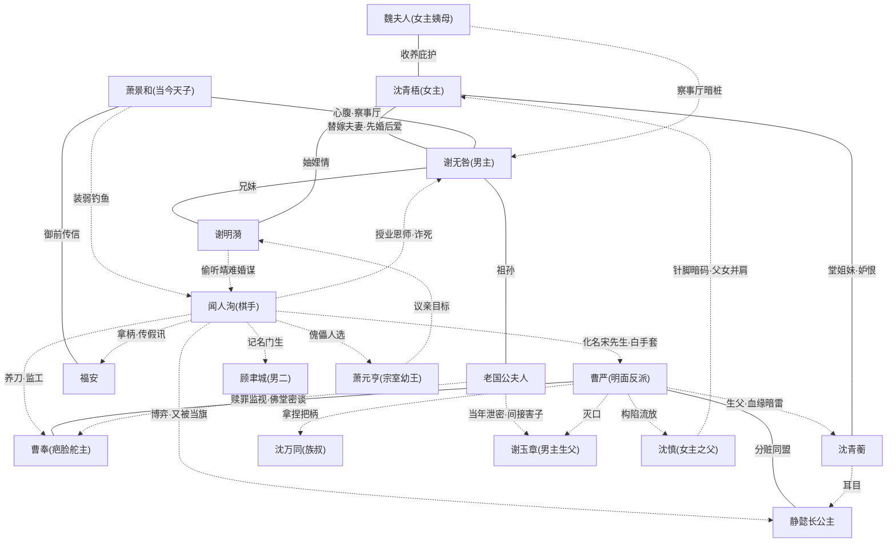

# 《折金枝》灵感与设定(明暗双线版)

> 📖 **教学注释**:本文件是全书的"户口本"。双线看「明线与暗线」小节;人设看"暗线身份"列——**每个人明面上的身份,和他真正在棋盘上的位置,往往不是一回事**。写正文卡住时回来对三样:一句话简介(没写偏没偏)、人物小传(人设崩没崩)、世界观(设定打架没)。

## 一句话简介

罪臣之女替嫁病弱权臣,先婚后爱共翻灭门旧案。

> 📖 教学注释:25 字内说清"谁 + 想要什么 + 最大障碍"。这句话是全书靶心,日后每个情节都问一句:"它在帮主角靠近这句话吗?"接不上的,砍。暗线不改变这句话,只给它加厚。

## 简介(约 200 字)

五年前,漕银三百万两沉江,大理寺卿沈慎背锅流放,永宁伯府一夜倾塌。
五年后,罪臣之女沈青梧顶着堂妹的名头,替嫁进安国公府——传闻那位病世子谢无咎,活不过三年。
新婚夜,她试探他药碗,他看穿她绣工;洞房花烛,各怀鬼胎。
她以为自己是曹党棋盘上的一枚弃子,却不知抬她进门的轿,是四只手一起放的:曹党想放钉子,谢无咎想护证据,族叔想甩包袱,她自己只想活。
直到账册暗格开启,她才发现——两桩灭门旧案出自同一支笔,而执笔人,就站在她丈夫的身后。
棋子与棋手,同婚一屋,同仇一案:这一次,换我把你从局里捞出来。

## 题材标签

古代言情 / 先婚后爱 / 权谋 / 宅斗 / 明暗双线 / 扮猪吃虎 / 双强联手 / HE

## 明线与暗线

> 📖 **教学注释**:双线不是"主线+支线"。明线给读者爽,暗线给读者"回头重看一遍"的回味——每层暗线揭开,前文所有细节换一种读法。纪律:**暗线每 3-5 章必须露一寸,不露等于没有;两线必须按"对表点"合流。**

| 线 | 内容 | 读者视角 | 功能 |
| --- | --- | --- | --- |
| 明线(金线) | 替嫁夫妻先婚后爱,联手查漕银沉船案、翻案昭雪 | 看得见的"破案+发糖" | 爽点与情感 |
| 暗线(墨线) | 漕银案是"靖难"的第一枚子:银养私兵,棋手借曹严做白手套、借长公主做旗帜;新帝装弱反钓;祖母赎罪暗哨;父女针脚传信 | 逐步揭盅的真相 | 反转与回味 |

**暗线三层反转**:
1. 一层(第 22 章揭):银未沉——三百万两养了三千漕丁私兵。
2. 二层(第 31-32 章揭半、第 45 章揭全):曹严只是白手套,棋手另有其人("宋先生");替嫁是四手棋局对撞。
3. 三层(第 48-52 章揭):棋手=男主授业恩师、察事厅首任首领闻人洵;新帝装弱三年钓的就是他;一对玉佩合契,开先帝遗诏匣。

## 爽点与看点清单

> 📖 教学注释:爽点是读者往下翻的理由。逐章大纲**每章必须至少挂一个**;本章没有爽点,就重写本章。

| 爽点 | 说明 | 密度 |
| --- | --- | --- |
| 双向扮猪吃虎 | 男女主都在装弱,层层拆穿 | 每卷 2-3 次 |
| 账目破局 | 女主以算账、背账立身 | 卷二起每卷必用 |
| 宅斗打脸 | 祖母、堂妹、族叔轮番上阵 | 卷一、卷二密集 |
| 身份揭露 | 察事厅、替嫁四手棋局、疤脸真身、外室女 | 大节点用 |
| 双线翻面 | 暗线揭盅,前文细节全线"回响" | 每层反转 1 次 |
| 沉冤昭雪 | 旧案翻案的正义快感 | 卷四总收 |
| 先婚后爱 | 契约夫妻的双向奔赴 | 全程暗线 |

## 世界观

### 时代与背景

架空大雍朝,立国百二十七年,国脉系于南北漕运。五年前,**漕银沉船案**:南方三百万两官银押运途中沉江。先帝命都察院左都御史**谢玉章**主审,他查出户部有鬼、未及结案便"暴毙"府中;协查的大理寺卿**沈慎**被指监守自盗,背锅流放岭南——但他没停手,在流放地以**针脚暗码**家书与女儿隔空并肩查案(新帝默许的"活证据")。
今上**萧景和**登基三年,被姑母**静懿长公主**掣肘内廷;户部尚书**曹严**与漕帮共掌财赋,是为曹党。而曹党背后另有一只手:先帝托孤重臣、察事厅首任首领**闻人洵**,五年前"病逝"——实则诈死,化名**宋先生**隐于曹府,漕银案正是他夺权布局的第一枚子。
新帝暗中重设察事厅,首领正是装病的谢无咎;新帝自己也在装弱——君臣二人都在钓鱼,钓的是同一条鱼。

### 地理格局

- **京兆**:朝堂主线;安国公府、曹府、长公主府、宫城。
- **江南·淮安**:漕运枢纽,沉船点**落雁滩**,私港**鸦渡**。
- 南北运河:全书空间线的主轴;漕丁私兵沿河散布。

### 势力与组织

| 势力 | 立场 | 实力 | 关键人物 |
| --- | --- | --- | --- |
| 安国公府 | 帝党外壳,内宅暗流 | 门第显赫 | 谢无咎、老国公夫人、谢明漪 |
| 曹党(户部+漕帮) | 明面反派 | 掌财赋与漕运 | 曹严、曹奉、沈青蘅(耳目) |
| 漕丁私兵 | 闻人洵暗养 | 三千漕丁,衣漕帮衣、吃漕银月钱 | 曹奉(监工)、闻人洵(真主) |
| 长公主府 | 被当旗帜的博弈者 | 把持内廷 | 静懿长公主 |
| 察事厅 | 帝党密探 | 情报网,见光死 | 谢无咎(首领)、魏夫人(京兆暗桩)、福安(宫内传信) |
| 清流文臣 | 中立偏帝 | 舆论与科第人脉 | 顾聿城(被暗中记名) |
| 永宁伯府(残) | 女主旧家 | 已抄没,族叔当家 | 沈万同(被拿捏)、沈青蘅 |

### 规则体系(世俗规矩,本书无超自然)

> 📖 教学注释:言情没有升级体系时,"规则"就写世俗规矩与制度——它们就是主角的墙。主角的每一次破局,都应是"借规则"而不是"违反规则没人管"。

- 圣旨赐婚不可违;**罪臣之女不入宗谱**——女主顶名替嫁是悬顶之剑,也是全书最大隐患。
- 察事厅听命天子、私设皇城,身份一旦暴露即"矫制"重罪,所以男主必须装弱;新帝同理——君臣互为镜像。
- 漕银账目分**三层账**(官账/帮账/私账)造假;女主的本事就是看穿三层。
- 关键道具:**一对玉佩**(沈家半块+闻人洵所持半块,**合契**方开**先帝遗诏匣**——内藏明诏托孤名单与暗诏"托孤臣有异心,持双佩者见禁军统领")、**《漕河图》屏风**(以绣载图)、**私铸钱范**(铭"洵"字工款,军资链物证)。
- 漕丁月钱走三层账的"私账",**名册即兵册**;代号"金枝"指长公主的分成银。

### 核心矛盾与主题

- 明线矛盾:沈谢两家旧案翻案 vs 曹党灭口与反扑。
- 暗线矛盾:靖难废立(闻人洵谋立宗室幼王**萧元亨**、自摄朝政) vs 少年天子亲政;棋手 vs "想做人的人"。
- 主题:满盘皆棋手,人人皆装弱;**敢先摊牌的人,才配赢**。沉冤昭雪靠证据一寸寸挖,也靠人心一寸寸认。

## 人物小传

> 📖 **教学注释**:四件套 = 欲望(想要什么)/ 恐惧(怕失去什么)/ 秘密(藏什么)/ 弧线(从头到尾变了吗);"暗线身份"列写他真正在棋盘上的位置。反派不是"坏",是**欲望与主角相撞**。每写一场戏问一遍:在场每个人分别被什么推着、拦着?

**人物网复杂度自查**:双重身份 5 组(谢无咎/曹奉/魏夫人/闻人洵/福安)✓;隐藏关系 ≥3 组(祖母泄密赎罪、父女针脚传信、姨母暗桩、记名门生)✓;镜像人物 ≥2 组(装弱二人:谢无咎 vs 萧景和;棋子女儿:沈青梧 vs 沈青蘅;师徒:闻人洵 vs 谢无咎)✓;血缘暗雷 ≥1 组(沈青蘅→曹严生父;老国公夫人→谢玉章亲子)✓。

| 姓名 | 明面身份 | 暗线身份 | 欲望 | 恐惧 | 秘密 | 弧线一句话 |
| --- | --- | --- | --- | --- | --- | --- |
| 沈青梧 | 安国公世子夫人(顶"沈青蘅"名替嫁) | 父亲针脚暗码的传信人;各方棋局的"公共棋子" | 先是翻案救父,后来翻的是"所有人为她定的局" | 身份败露;连累姨母 | 父亲塞她的半块玉佩,是一对玉佩之一、遗诏匣的钥匙;五年家书全是暗码 | 从被安排的棋子,到掀桌执棋的人 |
| 谢无咎 | 安国公世子,传闻风疾活不过三年 | 察事厅首领;先帝遗诏匣线索的追查者 | 查清生父谢玉章之死 | 重蹈生父覆辙;祖母与妹妹被牵连 | 装弱是演,寒毒风疾是真;授业恩师闻人洵"已死"——他不知道老师就是棋手 | 从独走夜路的孤臣,到把后背交出去的人 |
| 闻人洵 | 先帝托孤重臣,五年前"病逝" | 化名"宋先生",漕银案总设计师,谋靖难废立 | 以棋手之名重定天下:立幼王、自摄政 | 败于自己教出来的学生 | 察事厅是他创建的;他持另一半玉佩 | 从"以天下为棋"的宗师,到输给人心的落子人 |
| 曹严 | 户部尚书 | 白手套,至死不知棋手全貌 | 把漕运变成曹家私产 | 案发 | 挪银养丁、灭口构陷,皆奉"宋先生"之命 | 一路收紧,困死在自己造的假账里 |
| 静懿长公主 | 内廷之主,天子姑母 | 被当旗帜的博弈者;私记棋手行踪册多年 | 被承认——先帝曾许她监国而食言 | 失势 | 与曹党分赃,也防着曹党背后有人 | 从幕后执棋,到交出行踪册换体面 |
| 曹奉 | 曹府管事 | 漕帮舵主;闻人洵养大的刀、安插给曹严的监工 | 求一个"用得上"的位置 | 被弃如敝屣 | 只认"先生",曹严被蒙在鼓里 | 棋子的镜像:最后反咬真主求活 |
| 老国公夫人 | 谢家辈分最高者 | 赎罪暗哨:监视漕帮账房;当年泄查案进度间接害死亲子 | 保门楣,赎罪 | 秘密曝光害了孙儿 | 泄密之罪;袖中半张漕帮底账 | 从沉默的罪人,到堂前作证的老妇 |
| 沈青蘅 | 永宁伯嫡女,永安侯府媳 | 曹严外室女;曹党原定安进谢府的"钉子" | 保住窃来的嫡女身份 | 身世败露 | 生父是曹严;鎏金暖炉是生母旧物 | 从妒恨的棋子,到弑父证的女儿 |
| 顾聿城 | 新科探花,女主旧婚约 | 被闻人洵暗中记名的"清流旗子" | 重振家声,旧情复得 | 被人看不起 | 座师名帖有"宋"字私印;递过假情报而不自知 | 从被记名的棋子,到当庭揭师、自断棋路 |
| 萧景和 | 少年天子 | 装弱三年的钓者 | 亲政,拿回漕运与禁军 | 打草惊蛇,逼反棋手 | 五年压着旧案不许翻(怕惊蛇),对沈家有愧 | 从被掣肘的天子,到敢先摊牌的人 |
| 萧元亨 | 宗室幼王 | 傀儡人选:闻人洵谋立之君 | (稚子)平安长大 | 成为棋 | 无自知情 | 全书最无辜的一枚"棋" |
| 谢明漪 | 谢家嫡女 | 靖难婚谋的目标:嫁幼王萧元亨,绑谢家入局 | 嫂嫂当亲姊姊 | 兄长早逝 | 偷听到婚谋,暗记人名 | 从天真的小妹,到主动递出人证 |
| 魏夫人 | 女主姨母,京郊绣庄主 | 察事厅京兆暗桩,奉命"护孤"五年 | 女主周全 | 任务败露累及女主 | 收养是任务,绣样传信是职务 | 后方软肋,亦是软铠 |
| 福安 | 御前内侍 | 先帝暗匣守护人;其弟在漕帮当差,被拿捏 | 忠于新帝 | 弟死局破 | 被迫传过一次假讯;暗匣所在只有他知 | 双面小人物,关键时刻选对新主 |
| 沈慎 | 大理寺卿,流放岭南 | "戴罪查案"的活证据(新帝默许) | 保清白与家人 | 女儿被灭口 | 针脚暗码回传曹党动向五年;血书与玉佩是他留给女儿的翻案底牌 | 从背锅之臣,到暗线里没停过手的父亲 |
| 谢玉章 | 左都御史,已故 | 先帝钦命主审,被灭口 | (生前)查清漕银去向 | (生前)卷宗不齐 | 死前把半页空箱记录藏进谢家旧档 | 案源,两代人的执念 |
| 沈万同 | 永宁伯府当家 | 被曹严拿捏(藏其外室女之事) | 保住家产地位 | 把柄曝光 | 逼女主替嫁,实为替曹党递"钉子" | 精致的利己者,墙头草的收场 |

## 人物关系图

> 📖 **教学注释**:实线=明面关系,虚线=隐藏关系。任何人关系发生变化,回来改图,防"关系漂移"。这张图上虚线越多,暗线越厚——但每条虚线都必须在逐章大纲里有"露一寸"的章节。

