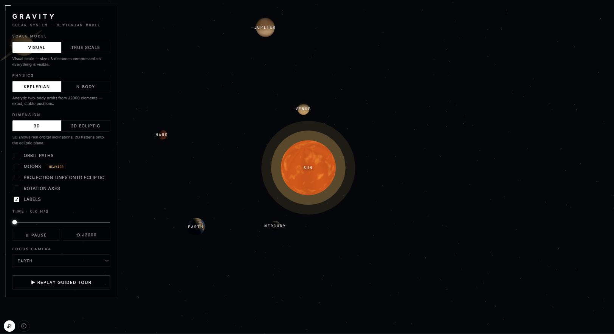
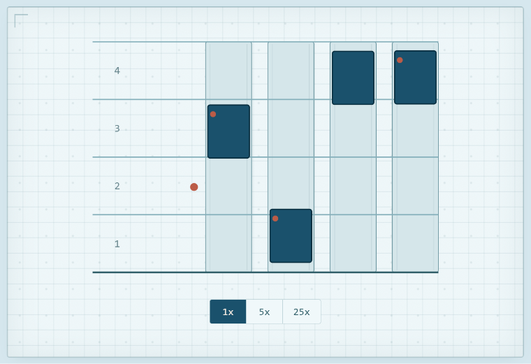
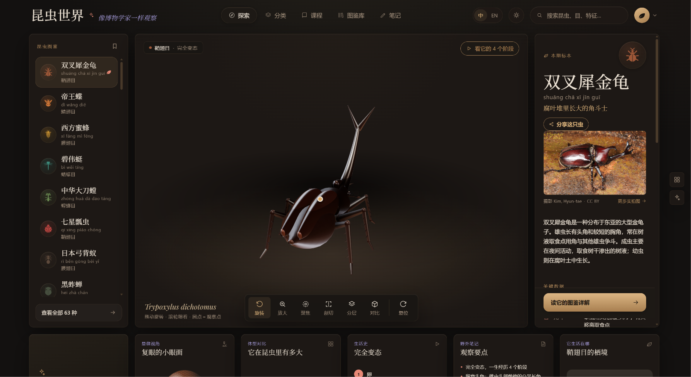
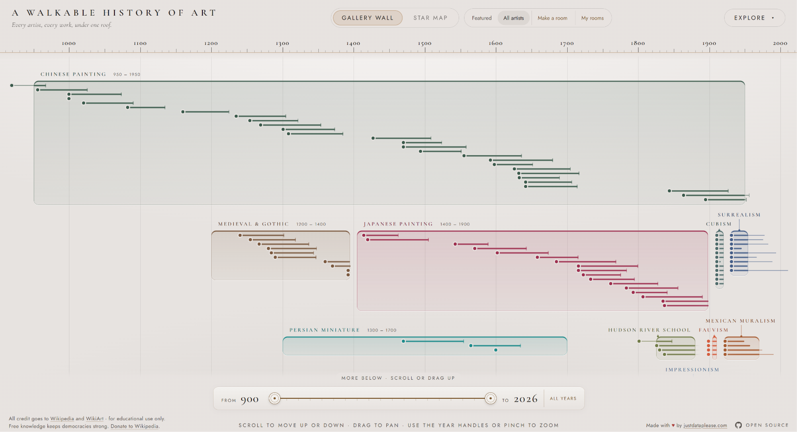

# KNG — 项目地图

> 技术栈:React 19 · TypeScript 6 · Vite 8 · MUI 9 · MobX-State-Tree · React Router 7 · dayjs
> 项目内容:自研表单组件库 + 智谱 AI 聊天页。**改代码前先读本地图,按图索骥,不要全库探索。**

## 目录结构

### 入口与配置(根目录)
- `index.html` — HTML 入口
- `vite.config.ts` — Vite 配置;含 `/api/zhipu` → 智谱 API 代理,密钥从 `.env.local` 的 `ZHIPU_API_KEY` 读取(未配置时中间件直接返回 500 报错)
- `tsconfig.json` / `tsconfig.app.json` / `tsconfig.node.json` — TypeScript 分包配置
- `eslint.config.js` — ESLint + Prettier 配置
- `constant.ts` — 全局常量(日期/时间格式)
- `tools.ts` — 通用工具函数(`waiting` 微任务延时)
- `global.d.ts` — 全局类型声明
- `.env.local` — 本地密钥 `ZHIPU_API_KEY`,不入库,勿读勿提交
- ⚠️ `theme/` — **废弃目录**:与 `src/theme/` 同名、无任何代码引用,唯一有效主题在 `src/theme/`,不要读、不要改
- ⚠️ `form-demo.tsx` — **废弃文件**:无任何引用,正式版在 `src/page/form-demo.tsx`

### src/ 源码
- `main.tsx` — 应用入口:RootStoreProvider → AppThemeProvider → AppRouter
- `app-router.tsx` — RouterProvider 挂载
- `page/` — 页面组件:`home`、`about`、`form-demo`、`ai-chat`(路由见下表)
- `router/` — 路由模块:`config.ts` 路由表、`router.tsx` 创建 router 并套 layout、`lazy-route.ts` 页面懒加载封装
- `layout/` — 全局布局:`app-layout`(Header + Footer + Outlet)、`app-header`、`app-footer`、`root-wrapper`
- `component/` — 通用组件,经 `component/index.ts` 桶导出
  - `button/` — 按钮变体(contained / outlined / text / normal / wrapper)
  - `form/` — 自研表单组件集:text、area、checkbox、email、numeric、digital、date、date-time、period、radio-group、select、dropdown、form-element/form-base 公共底座;`use-form/` 为表单状态机(value / field / state / rule / error 五个模块)
  - `typography/` — 文本组件(title-level-1/2/3、text-normal/secondary/small、text-link)
  - `loading.tsx` — 加载指示
- `theme/` — MUI 主题:`theme.ts` 的 createAppTheme、`light/dark-palette.ts` 调色板、`form-config.ts` 表单主题定制、`theme-provider.tsx`(跟随 store 切换明暗)、`theme-augmentation.d.ts` 类型扩展
- `store/` — MobX-State-Tree 状态管理:`root-model` / `root-init` 根模型、`store-context` + `use-stores` 注入取用、`init-state/` 初始状态、`store-model/` 领域模型(目前仅 base)
- `ai/` — 智谱 AI 封装:`zhipu.ts` OpenAI 兼容客户端(chat / listModels,返回 usage 统计)、`workspace.ts` 聊天页文件附加与写入助手。**详细文档见 `src/ai/README.md`,AI 相关问题先读它**
- `hook/` — `use-common.ts` 公共 hooks
- `assets/` — 静态图片资源
- `text.md` — 空文件(占位/待清理)

## 路由表

| 路径 | 页面 | 源文件 |
|---|---|---|
| `/` | 首页 | `src/page/home.tsx` |
| `/about` | 关于 | `src/page/about.tsx` |
| `/form-demo` | 表单演示 | `src/page/form-demo.tsx` |
| `/ai-chat` | AI 聊天(智谱) | `src/page/ai-chat.tsx` |

## 常用命令

- `npm run dev` — 启动开发服务器(需先在 `.env.local` 配置 `ZHIPU_API_KEY`)
- `npm run build` — 类型检查(tsc -b)+ 构建
- `npm run lint` — ESLint 检查
- `npm run preview` — 预览构建产物

## 给 Agent(Cline)的阅读约定 — 省 token

1. 先读这份地图,直达目标文件,不要列目录逐个探索
2. **禁止读取**:`package-lock.json`、`src/assets/**` 下图片、废弃的根目录 `theme/` 与 `form-demo.tsx`
3. 主题相关改动只动 `src/theme/`;AI 相关问题先读 `src/ai/README.md`
4. 读取大文件(如 `src/page/ai-chat.tsx`,约 1000 行)时优先按行号范围取所需片段

---

## 使用Cline
### 打开 VSCode 插件市场，搜索 cline 安装
### 在 Cline 里选择 “Use your own API Key”，API Provider 选 OpenAI Compatible
### Base URL 填 https://open.bigmodel.cn/api/paas/v4，API Key 填你平台上的密钥
### 模型选“使用自定义”，输入 glm-5.3-flash（你的赠送资源包正好适用）

## [太阳系](https://qunabu.github.io/Gravity/#third-cosmic)

## [Elevators](https://john.fun/elevators)

## [昆虫的世界](https://insect-world.pages.dev/)

## [Artmuseum](https://artmuseum.artfrompixels.com/)

## [阅古文](https://yueguwen.com/)

