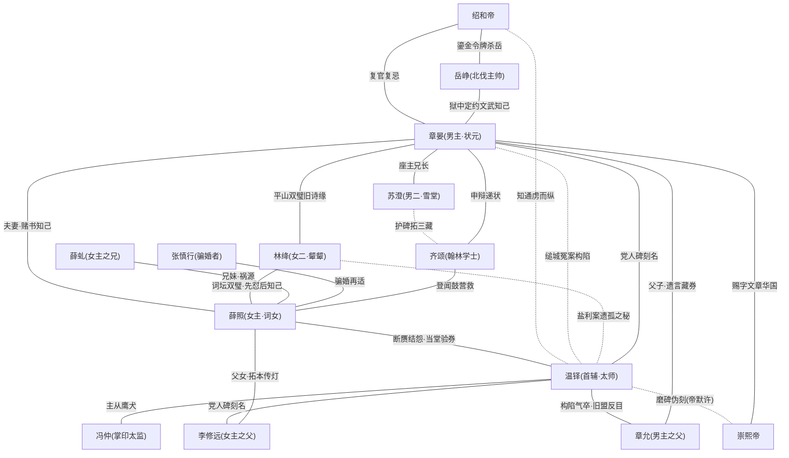

# 《归来堂》灵感与设定

> 📖 教学注释:这是全书的"户口本"。写正文卡住时回来对三样:一句话简介(没写偏没偏)、人物小传(人设崩没崩)、世界观(设定打架没)。

## 一句话简介
状元与词女乱世守文脉,党争与虏骑步步焚毁。

## 简介(约 200 字)
丙辰科状元章晏,十六岁金陵阅江楼一序惊天下,醉里仗剑,狂称"小谪仙";皇商薛氏女薛照,一部《词品》骂遍当世词人,白日当家理事,夜里赌书泼酒。一纸"照书归"的残碑梦谶,让两个不肯低头的人成了政治联姻的夫妻——赌书泼茶,金石满堂。直到党人碑把两家名字刻上耻辱柱,直到黑水川一场溃败,皇帝被掳,京师围城:他"死"在北地,她"嫁"进骗局。他从虏帐里偷出亡国的证据,她从骗局里告出科场的舞弊;他在诏狱里等一个翻案,她在登闻鼓下敲响读书人的脊梁。山河可以偏安,文脉不许低头——归来堂的门楣上,刻着那三个字:照书归。

## 题材标签
架空历史 / 历史言情 / 权谋党争 / 双强双向 / 家国文脉(悲剧底HE)

## 爽点与看点清单
| 爽点 | 说明 | 密度 |
| --- | --- | --- |
| 即席挥毫 | 《阅江楼序》一序惊天下,名句传抄海内 | 卷一集中 |
| 毒舌词论 | 《词品》骂遍当世词人,禁书反而更贵 | 高频 |
| 掌眼鉴宝 | 薛照断赝鼎伪帖打脸权贵权相 | 高频 |
| 状元及第 | 丙辰科传奇榜,帝批"为子孙得太平宰相" | 卷一 |
| 赌书泼茶 | 夫妻日常糖分,归来堂名场面 | 每卷一拍 |
| 宴射连中 | 章晏虏宴连射十中,虏使折服 | 卷二 |
| 击登闻鼓 | 女主为夫鸣冤,敲响读书人脊梁 | 卷四 |
| 当堂验券 | 金石辨伪当堂翻案,技术流大女主巅峰 | 卷四 |
| 双狱文武 | 诏狱中文武知己定约,泪点与风骨 | 卷四 |
| 门楣谶成 | "照书归"三字应验,首尾点题 | 终章 |

## 世界观
### 时代与背景
架空王朝国号"大明",制度称谓皆用明制,国运轨迹整体模拟北宋:洪业帝开国,夜宴五府都督收兵符,太庙立誓碑(不因言罪士、不夺武臣世职、毋弃中原),赐武臣丹书铁券;永熙帝守成;嘉宁帝在位四十二年仁治,与北虏定"云朔之盟"始有岁输;熙崇帝锐意变法,倚温铎十五年而早崩;崇熙帝以皇弟入继,书画玄修,温党专政,立党人碑、行珍玩纲;黑水川之败(改元靖平)崇熙帝被掳北狩,京师围城后城下之盟割云朔三镇;绍和帝仓皇即位,南迁金陵偏安,禁私史,鎏金令牌召回北伐主帅岳峥死于诏狱。
### 地理格局
京师(北都,割镇后残破)/ 金陵(南都行在,绍和朝都城)/ 姑苏(苏州府,林氏世居,女主流寓地)/ 青州(山东,归来堂故址,后沦陷)/ 云州与云朔三镇(北边)/ 琼崖(海南贬所)/ 扬州平山堂(诗会旧地)/ 阅江楼(金陵,男主成名地)/ 枯城(北虏地,崇熙帝殂处)/ 黑水川(溃败地)。
### 势力与组织
| 势力 | 立场 | 实力 | 关键人物 |
| --- | --- | --- | --- |
| 行在朝廷(绍和朝) | 偏安猜忌 | 名存实危 | 绍和帝 |
| 温党(新党权臣集团) | 专权通虏 | 三朝盘根错节 | 温铎、冯仲 |
| 旧党清流(誓碑派) | 护碑护脉 | 党禁后零落 | 苏澄、齐颂 |
| 勋贵四家 | 贾府(国公府)、史、王、薛(皇商) | 党禁与抄没中倾覆 | 史太君、薛虬 |
| 漱玉阁 | 章薛夫妇藏书楼 | 金石书画三万卷 | 章晏、薛照 |
| 北虏 | 外患 | 铁骑坐大,岁输养之 | 可汗(虚写) |
| 归正人 | 南归被掳士民 | 被猜忌被编管 | 章晏同掳者 |
### 规则体系
无超自然。制度规矩:科举殿试(状元、琼林宴)、党禁与党人碑(立于国子监,刻名者子孙不得科举)、私史之禁、妻告夫律(徒三年;以庶民身份击登闻鼓可绕开此律)、丹书铁券制度、女官六局一司待选、归正人编管、岁输制(云朔之盟)、锦衣卫诏狱。关键道具:太庙誓碑、丹书铁券、《词品》《漱玉录》《颦颦残稿》《乌江》诗稿、《靖平实录》《围城日录》《北虏策》《岁输考》《投齐公启》、桦弓、证物匣。
### 核心矛盾与主题
文与刀(士人之笔、武人之剑、皇权之忌);真与伪(伪碑对真券,信任之毁与重建);家与国(个人才情幸福在王朝崩解中的位置)。主题句:山河可偏安,文脉不偏安;碑可以毁,口不可封。

## 人物小传
> 📖 教学注释:四件套 = 欲望/恐惧/秘密/弧线;"暗线身份"列写他真正在棋盘上的位置。每写一场戏,问一遍:在场每个人分别被什么推着、拦着?
复杂度基线核对:双重身份 ≥3 组(章晏状元/持券后裔与虏廷记室,薛照才女/辨伪证史者,温铎名相/通虏者,齐颂学士/护碑义士);隐藏关系 ≥3 组(章晏-林绛平山旧缘、章允-温铎旧盟反目、苏澄-齐颂护碑网络、崇熙帝-温铎磨碑共谋);镜像人物 ≥2 组(章晏vs岳峥文武互照、薛照vs林绛钗黛对照、苏澄vs温铎旷达与权欲、嘉宁帝vs崇熙帝盛世与亡国);血缘暗雷 ≥1 组(章氏铁券:章晏祖上是开国持券武臣后裔);反派分层:温党爪牙(明面)→冯仲(白手套)→温铎(幕后棋手)→绍和帝猜忌与伪碑信任之毁(制度之恶)。

| 姓名 | 明面身份 | 暗线身份 | 欲望 | 恐惧 | 秘密 | 弧线一句话 |
| --- | --- | --- | --- | --- | --- | --- |
| 章晏 | 十六岁以《阅江楼序》惊天下→丙辰科状元→翰林修《编年通载》→青州屏居→知云州→北地被掳→归正人→诏狱罪臣→布衣修史;号玉溪,狂称"小谪仙";《无题》诗集传世成公案 | 开国丹书铁券持券人后裔(不自知);虏廷密约的记诵者,暗线铁证的活载体 | 以笔安天下 | 笔终不敌刀,文章救不了山河 | 家藏铁券之秘;虏主所赐桦弓;北地记诵温铎密约全文 | 少年天才→党争夹缝→缒城之耻→北地持节→轻舟已过→归堂得真 |
| 薛照 | 皇商薛氏女→待选女官→当朝词坛第一才女(《词品》骂遍天下)→归来堂主母→流寓孤寡→再适离异者→《漱玉录》撰者;小字宝章,号蘅芜主人 | 金石辨伪第一人,誓碑真伪的最早证伪者(不自知起步),暗线证据链的技术核心 | 守家守书守他 | "无情"之名成真;乱世之中一文不值 | 父遗真碑拓本藏于嫁妆夹层;《词品》独骂林绛最狠的私心 | 藏愚守拙→以词立世→护书南渡→宁碎不屈(《乌江》之悔)→归来得暖 |
| 林绛 | 姑苏林氏孤女→投依外祖贾府史太君→词坛双璧之一;小字颦颦 | 巡盐御史林淮盐利案遗孤,父之死连着温党盐利暗线 | 诗酒风华,一人之心 | 入世之浊;才名沦为党争武器 | 平山双璧旧缘(与章晏少年文字之交);父遗盐案卷宗 | 孤高→痴→泪尽→《颦颦残稿》传世 |
| 苏澄 | 翰林学士→屡贬至琼崖;字子瞻,号雪堂 | 旧党旗帜,誓碑派护碑人,托拓分藏三处 | 旷达自渡渡人 | 党祸牵连门生 | 每贬一次实为替章晏挡一次刀 | 亦师亦兄→一贬再贬→此心安处→坡翁 |
| 温铎 | 内阁首辅→太师,书法宗师 | 通虏者,誓碑伪刻者,盐利岁输网主 | 万世名相之名 | 誓碑真文与铁券现世 | 与北虏密约国书;党人碑伪文;磨碑经崇熙帝默许 | 权倾三朝→伪碑者→碑毁人诛 |
| 冯仲 | 司礼监掌印太监 | 温党白手套,盐引岁输经手人,密约原本持有人 | 内相之权 | 做弃子 | 密约国书原件藏于己手 | 权阉→弃子→反水自保→伏诛 |
| 崇熙帝 | 皇帝,书画宗师,玄修 | 磨碑共谋者(默许温铎改碑) | 万世艺名 | 北狩之辱 | 临终悔言"碑是朕许磨的" | 文艺天子→黑水川被掳→枯城悔死 |
| 绍和帝 | 南渡皇帝 | 知温铎通虏而纵之(需其稳局);默许岳峥之死 | 偏安稳坐 | "迎还北狩"呼声 | 准了鎏金令牌与诏狱 | 仓皇即位→偏安猜忌之主 |
| 岳峥 | 大都督府左都督,北伐主帅 | 最干净的人(无暗线) | 还我河山 | 迎还北狩触帝忌而不自知 | 遗言"文官不爱钱,武官不惜死" | 黑水川残部→守京师→北伐→鎏金令牌→诏狱国殇 |
| 章允 | 章晏之父,吏部尚书→次辅 | 铁券藏匿者;温铎早年盟友,后反目 | 变法成事 | 儿子被党争吞没 | 铁券藏青州归来堂夹壁;临终遗言"祖物勿失" | 变法干将→被构陷气卒→死藏一券 |
| 李修远 | 薛照之父,礼部郎中,苏门学士 | 旧党护碑派,持嘉宁朝真碑拓本 | 文脉不坠 | 女儿无依 | 真碑拓本传女 | 护碑→党人碑刻名→贬死→拓本传灯 |
| 薛虬 | 薛照之兄,呆霸王,皇商接班人 | 无 | 逍遥挥霍 | 官府刑名 | 打死人命避祸进京;犒虏纲银挪用 | 纨绔→祸源→纲沉家灭 |
| 张慎行 | 中书舍人 | 骗婚者,觊觎漱玉阁残藏 | 财与势 | 科场舞弊败露 | 虚报举数入官 | 驵侩→骗婚→败露→编管 |
| 齐颂 | 南京翰林学士 | 綦崇礼式义士,旧党遗珠,代藏苏澄护碑拓 | 公道与文脉 | 党祸 | 代藏护碑拓第三份 | 义助两狱,文林之友 |

## 人物关系图
> 📖 教学注释:实线=明面关系,虚线=隐藏关系。关系变了回来改图,防"关系漂移"。

