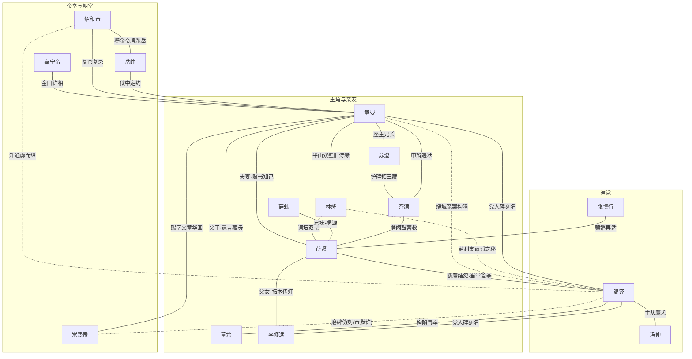

# 《归来堂》人物图谱与时空线

> 📖 教学注释:这是全书的"地图与挂钟"。写正文前对三样:关系演变(人物关系崩没崩)、时间轴(年龄穿帮没)、地点线(场景漂移没)。03 逐章大纲的「时间」「地点」两列必须与本文件一致。

## 人物关系图谱
> 📖 教学注释:总图谱按阵营分组(subgraph),比 01 的核心关系图更全:所有重要人物都挂进阵营;实线=明面关系,虚线=隐藏关系,连线标注"关系性质"。节点 id 纯 ASCII,中文放双引号标签。

### 总图谱(按阵营分组)

### 阵营说明
| 阵营 | 成员 | 立场 | 备注 |
| --- | --- | --- | --- |
| 主角与亲友 | 章晏、薛照、林绛、章允、李修远、薛虬 | 文脉守护线 | 林绛为钗黛对照之镜 |
| 清流盟友 | 苏澄、齐颂 | 护碑派旧党 | 苏澄屡贬挡刀 |
| 温党 | 温铎、冯仲、张慎行 | 通虏卖国 | 温铎兼幕后棋手 |
| 帝室与朝堂 | 嘉宁帝、崇熙帝、绍和帝、岳峥 | 盛世—亡国—偏安 | 岳峥为最干净的人 |

### 关系演变表
| 关系 | 起点状态(章节) | 转折事件(章节) | 终点状态(章节) |
| --- | --- | --- | --- |
| 章晏↔薛照 | 笔战冤家(1-4) | 谶婚联姻(8-10)/缒城污名死讯(51-54)/双向谷底(63-68) | 狱门重逢悔诗(71),归来堂共碑赌书(74/100) |
| 章晏↔林绛 | 平山旧缘(5-7) | 无题解人(43)/流言(43-44) | 焚稿诀别(56),残稿传世(84) |
| 薛照↔林绛 | 词社相轻(8/13) | 双璧交心(44) | 托稿(56),刊稿作序(84) |
| 章晏↔苏澄 | 同榜座主(6) | 护碑同盟(37/42) | 琼崖序(83),坡翁之葬(96-97) |
| 章晏↔温铎 | 拒亲结怨(9) | 构陷父案(19)/党人碑(24)/虚附周旋(28-36) | 当堂对质(69),史观对决(70) |
| 薛照↔温铎 | 断赝打脸(4) | 掌眼破伪帖(29) | 当堂验券翻案(69) |
| 章晏↔岳峥 | 边报相知(46) | 援绝(52)/同狱定约(67) | 诏狱国殇(70),祠碑入石(80) |
| 温铎↔冯仲 | 主从鹰犬(29) | 弃子反水献密约(69) | 同归败亡(70-73) |
| 绍和帝↔章晏 | 复官修史(71-72) | 归正人案猜忌(77)/私史之禁(79) | 赐匾辞官(86) |

## 时间线
> 📖 教学注释:纪年体系定稿后不再改;主角年龄是硬约束,逐章「时间」列从这里取值。

### 纪年体系
| 纪年 | 说明 | 备注 |
| --- | --- | --- |
| 洪业 | 开国太祖年号 | 夜宴五府都督,立誓碑赐铁券 |
| 永熙 | 守成年号 | 承平无事 |
| 嘉宁 | 盛世年号,在位四十二年 | 卷一开篇于嘉宁四十年 |
| 熙崇 | 变法年号,五年 | 熙崇帝锐意变法而早崩 |
| 崇熙 | 党禁年号,七年 | 崇熙帝亲征被掳 |
| 靖平 | 北狩监国年号,约一年 | 黑水川之败后改元,透着不祥 |
| 绍和 | 南渡偏安年号,十一年以上 | 绍和帝即位于南迁 |

### 主线时间轴
| 阶段/卷 | 故事内时间跨度 | 章晏/薛照年龄 | 关键事件 | 对应章节 |
| --- | --- | --- | --- | --- |
| 卷一 金陵玉屑 | 嘉宁四十年—熙崇五年 | 16→24 / 15→23 | 成名·状元·联姻·党人碑 | 1-22 |
| 卷二 党人碑 | 崇熙元年—六年 | 25→30 / 24→29 | 查碑潜伏·外放戍边 | 23-50 |
| 卷三 北狩录 | 崇熙七年—绍和二年 | 31→34 / 30→33 | 黑水川·围城·南渡·翻案重逢 | 51-75 |
| 卷四 归来堂 | 绍和三年—十一年 | 35→43 / 34→42 | 岳碑·书成·传灯 | 76-100 |

### 人物年龄对表
| 人物 | 卷一 | 卷二 | 卷三 | 卷四 | 备注 |
| --- | --- | --- | --- | --- | --- |
| 章晏 | 16-24 | 25-30 | 31-34 | 35-43 | 嘉宁四十一年十七岁少年状元 |
| 薛照 | 15-23 | 24-29 | 30-33 | 34-42 | 小章晏一岁,大婚时十七 |
| 林绛 | 14-22 | 23-28 | 29-32(殁) | — | 小章晏两岁,围城中泪尽 |
| 苏澄 | 26-34 | 35-40 | 41-44 | 45-51(卒) | 长章晏十岁,坡翁 |
| 岳峥 | — | 55-60 | 61-64(卒) | — | 长章晏三十岁,死于诏狱 |
| 温铎 | 51-59 | 60-65 | 66-69(诛) | — | 长章晏三十五岁,三朝权相 |

## 地点线
> 📖 教学注释:地点线管"人在哪、路怎么走"。人物迁徙必须连续(上一站→下一站有路径),防瞬移穿帮;03 逐章「地点」列从这里取值。

### 地理格局总览
| 地点 | 归属 | 与主线关系 |
| --- | --- | --- |
| 金陵 | 南都·绍和行在 | 男主成名地(阅江楼),卷四主场景,终章 |
| 京师 | 北都 | 卷一后段—卷二主场景,靖平之变后沦陷 |
| 姑苏 | 苏州府 | 林氏世居,女主流寓,再适骗局 |
| 青州 | 山东 | 归来堂故址,卷二屏居,后沦陷 |
| 扬州平山堂 | 运河要冲 | 平山双璧旧地 |
| 云州·云朔三镇 | 北边 | 卷二末—卷三初战地 |
| 黑水川 | 北边 | 亲征溃败地 |
| 北虏王庭·枯城 | 北地 | 男主被掳地,帝崩处 |
| 循州 | 岭南 | 女主父贬所 |
| 琼崖 | 海南 | 苏澄贬所 |
| 运河·长江 | 南北命脉 | 南渡与迎柩路线 |

### 逐卷主要场景
| 卷 | 主要地点 | 关键场景 | 对应章节 |
| --- | --- | --- | --- |
| 卷一 | 金陵 | 阅江楼、薛家铺、贾府词社 | 1-5/8 |
| 卷一 | 京师 | 贡院、琼林宴、漱玉阁、太庙外 | 6-19 |
| 卷一 | 青州 | 归来堂 | 20-21 |
| 卷二 | 京师 | 国子监党人碑、太庙、司礼监 | 23-46 |
| 卷二 | 云州 | 边城、宴射 | 47-50 |
| 卷三 | 云州—黑水川 | 守城、溃败 | 51-53 |
| 卷三 | 京师 | 围城、城下之盟 | 54-58 |
| 卷三 | 长江—金陵 | 南渡、诏狱、码头宣读 | 59-75 |
| 卷三 | 北地 | 王庭、枯城 | 61-62 |
| 卷三 | 姑苏 | 再适离异 | 63 |
| 卷四 | 金陵 | 归来堂、国子监碑亭、阅江楼 | 76-100 |
| 卷四 | 运河 | 迎柩 | 76 |

### 人物迁徙路线
| 人物 | 迁徙路线(按时间序) | 对应章节 |
| --- | --- | --- |
| 章晏 | 金陵→京师(科举)→青州(屏居)→京师(起复)→云州(外放)→黑水川(被掳)→北虏王庭→枯城→金陵(诏狱)→金陵(归来堂)→运河(迎柩)→金陵 | 1-100 |
| 薛照 | 金陵→京师(待选寄居)→青州→京师→循州(侍疾)→京师(围城)→姑苏(南渡流寓)→金陵(归来堂) | 1-100 |
| 林绛 | 姑苏→京师(贾府)→(围城中殁) | 7-56 |
| 苏澄 | 京师→贬所江南→琼崖→金陵(卒) | 6-96 |
| 岳峥 | 云朔边关→京师(入卫)→北伐→诏狱(殁) | 46-70 |

### 可复用场景清单
| 场景 | 关联地点/人物 | 已用章节 |
| --- | --- | --- |
| 归来堂 | 章晏、薛照 | 20-21/73/87-100 |
| 漱玉阁 | 夫妻、温党查抄 | 11/17-18/36 |
| 国子监 | 党人碑、重立誓碑 | 24/74/98 |
| 诏狱 | 章晏、岳峥 | 64/67-70 |
| 贾府 | 林绛、史太君 | 8/31/56 |
| 阅江楼 | 章晏 | 2/99 |
