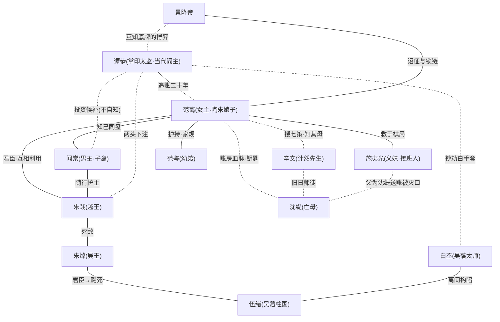

# 《陶朱娘子》灵感与设定

> 📖 教学注释:这是全书的"户口本"。写正文卡住时回来对三样:一句话简介(没写偏没偏)、人物小传(人设崩没崩)、世界观(设定打架没)。

## 一句话简介
灭门商女靠一手好账破局,满盘棋手都想收她为子。

## 简介(约 200 字)
现代金融分析师范离,一睁眼成了架空大明"通番案"里满门抄斩后唯一幸存的疯女。族伯要吞她的产,官府要结她的案,连亲弟弟都指望不上。她靠母亲留下的半枚玉算盘和一手现代经济学,从账房杀进质子府,再杀进司礼监的棋局——她惊觉这世道竟与史书里范蠡的越国一步步押着同样的韵脚:战败、为奴、十年生聚、兔死狗烹。别人穿越是改命,她穿越是活成了自己论文里写过的那个人。但这一世,美人计不必献,文种不必死,良弓不必藏进匣子里发霉。旱则资舟——她要造一艘谁也抢不走的船。

## 题材标签
架空历史 / 女频权谋 / 商战种田 / 强强联手 / HE

## 爽点与看点清单
| 爽点 | 说明 | 密度 |
| --- | --- | --- |
| 扮猪吃虎 | 疯女藏智,公堂装疯骗过全城唯独骗不过男主 | 高频 |
| 打脸夺产 | 开局智斗族伯守备,夺回范家产业 | 卷一集中 |
| 知识碾压 | 复式记账、期货思维、反周期操作吊打古代商战 | 高频 |
| 以商灭国 | 不献美人,用货币战争掏空吴藩(倒钞、粮战、离间) | 卷三总攻 |
| 预判帝王心性 | 先知"兔死狗烹",每次都把退路算在明处 | 卷二起持续 |
| 双向奔赴 | 男主每次都站她:拒调、抗旨、砸玉佩反救 | 每卷一拍 |
| 身份揭露 | 疯女→掌柜→国士→陶朱娘子,层层递进 | 每卷进阶 |
| 三散家财 | 散财不是慷慨,是"让财富不可劫持" | 卷四三次 |
| 孤身入虎穴 | 密库取档、越营摊牌,算无遗策 | 卷三、卷四 |
| 救夫名场面 | 以天下之账赎一人之命,改写文种悲剧 | 卷四高潮 |

## 世界观
### 时代与背景
架空大明,景隆年间。先帝承平帝晚年滥发宝钞致钞法崩坏,北狄屡犯北疆,诸藩坐大。景隆帝以旁支入继、司礼监掌印谭恭扶立,帝权与阁权暗斗。吴藩居金陵最强,越藩居山阴战败称臣——全书在"北廷—吴藩—越藩"三角与"明面朝局—暗面计然阁"双层棋盘上展开。
### 地理格局
京师(北廷中枢)/ 金陵(吴藩都城,内有软禁女主的安人府)/ 山阴(越藩都城)/ 宛陵(越地商埠,范家所在,织造重镇)/ 北疆马市 / 运河漕运线 / 陶丘(齐地商埠,卷四二次创业地)/ 五湖(终局退隐地)。
### 势力与组织
| 势力 | 立场 | 实力 | 关键人物 |
| --- | --- | --- | --- |
| 北廷(朝廷) | 坐山观虎斗,战后收网 | 名义天下共主,财政被宝钞拖垮 | 景隆帝、谭恭 |
| 吴藩 | 强藩,欲入主北廷 | 兵强马壮,财政空心 | 朱焯、伍绪、白丕 |
| 越藩 | 战败弱藩,卧薪复仇 | 先弱后强 | 朱践、闻崇、范离 |
| 计然阁(暗线) | 三百年隐世组织,以商控国,历代阁主号"计然" | 掌钞法、汇通号、白手套网络 | 谭恭(当代阁主)、辛文(叛阁账房) |
| 平准行(女主终建) | 商盟,平物价济灾荒 | 从无到有,终成天下人心 | 范离、施夷光 |
| 江南商帮/织户 | 苦钞法久矣 | 民心与钱袋 | 各州行会 |
| 资舟号 | 女主商号,明为买卖暗为情报网 | 起于宛陵,遍布南北 | 范离 |
| 北狄 | 外患 | 骑军强,财赋弱 | 王庭(虚写) |
### 规则体系
无超自然。世俗规矩:藩王入质、司礼监批红、开中法盐引、宝钞与倒钞法、海禁与"通番"死罪、女子身契与婚权。暗线规则:计然阁代际传承、账房血脉、阁规处置(灭范家即阁规)。金手指边界:女主只有现代经济学与对人性周期的理解;她记得"范蠡的故事",但这是架空大明,韵脚会对不上——先知随时失灵,失灵时只能靠自己。关键道具:《承平钞档》(黑账)、半枚玉算盘(密库钥匙)、鹤顶红(宫中赐死规格)、复式账法。
### 核心矛盾与主题
三百年"以商乱国"的阁道 vs 女主"以商利民"的制度创新;帝王"可与共患难不可与共乐"的人性账 vs 女主"知进退"的生存智慧。主题句:旱则资舟——船常在,人不必在。

## 人物小传
> 📖 教学注释:四件套 = 欲望/恐惧/秘密/弧线;"暗线身份"列写他真正在棋盘上的位置。每写一场戏,问一遍:在场每个人分别被什么推着、拦着?
复杂度基线核对:双重身份 ≥3 组(范离/闻崇/谭恭/施夷光/辛文)、隐藏关系 ≥3 组(沈缇-辛文师徒、谭恭-闻崇投资、朱践-北狄密通、白丕-汇通号、夷光之父-沈缇)、镜像人物 ≥2 组(闻崇vs伍绪、范离vs施夷光、范离vs谭恭、朱践vs景隆帝)、血缘暗雷 ≥1 组(沈缇-范离账房血脉);反派分层:族伯/守备/白丕(明面)→汇通号(白手套)→谭恭(棋手)→朱践与景隆帝的"锁链逻辑"(终局之局)。

| 姓名 | 明面身份 | 暗线身份 | 欲望 | 恐惧 | 秘密 | 弧线一句话 |
| --- | --- | --- | --- | --- | --- | --- |
| 范离 | 疾女→范掌柜→质邸账房→越藩度支幕后掌盘→陶朱娘子;表字少伯,男主所赠 | 计然阁账房血脉,《承平钞档》线索持有者,穿越者 | 先护家护产,后终结"以商乱国" | 重蹈"良弓藏"覆辙;自己活成谭恭 | 穿越者;前世写过范蠡论文;黑账真本线索 | 从"只想逃"到"敢执棋"再到"制度化地退" |
| 闻崇 | 巡按御史→越地推官→质邸属官→越藩左长史→户部郎中;表字子禽 | 谭恭"养"的下一代阁主候选,自己不知情 | 在君臣之义内得清名,护她周全 | 被当棋子;辜负她 | 谭恭旧信与玉佩(投名状) | 从"孤忠之臣"到"与她同盘之人" |
| 朱践 | 越王:战败质子→复国雄主→监国 | 曾密通北狄欲借外力 | 雪耻,终而南面称制 | 再为奴;失去掌控 | 北狄密信;为奴自辱的隐痛 | 从隐忍之主到孤家寡人,读懂自己的账后退半步 |
| 朱焯 | 吴王:强藩之主,骄主 | 贡银入北廷买储位 | 入主北廷 | 被看穿空虚 | 军费空心;私通北廷 | 不可一世→众叛亲离→蒙面自尽"无面目见伍绪" |
| 伍绪 | 吴藩柱国;表字子淮 | 早知吴不可救仍死谏 | 护吴护民 | 吴亡民屠 | 预言"拿账当刀者自食之" | 忠臣立于败局仍护民,死前留字成全书判词 |
| 白丕 | 吴藩太师→左相 | 汇通号白手套,收越商贿 | 权与钱 | 账本见光 | 私吞军屯;暗备卖城退路 | 贪得无厌→众矢之的→市斩 |
| 谭恭 | 司礼监掌印太监,人称"谭翁" | 当代计然阁阁主 | 以财脉控国运,阁道永续 | 黑账公之于众;阁脉断 | 灭范家是前任阁令,他追账二十年 | 操控一切的棋手被"账"反杀,死前留下"阁不亡"的诅咒 |
| 施夷光 | 浣纱女→女掌柜→商盟执读 | 灭口船工之女,女主义妹与接班人 | 不做棋子做棋手 | 再被献出 | 父亲之死与沈缇案同源 | 从被救者到敢死之士到传承者 |
| 辛文 | 卖卦老人,人称"计然先生" | 计然阁前代账房,叛阁者 | 见阁道被纠正 | 阁脉落在谭恭路线上 | 沈缇之师;名录中被朱笔勾除者 | 传道、见证、淡出 |
| 沈缇 | 范离之母(亡故) | 计然阁账房世家,藏真本而死 | 护女护账 | 女儿被阁寻回 | 黑账真本藏处(歌谣为引) | 以回忆出场,全书暗线的原点 |
| 景隆帝 | 北廷皇帝 | 知"阁"存在,与阁博弈 | 收权亲政 | 被架空的旧账曝光 | 想借女主拆阁,更想吞平准行 | 傀儡→亲政→读懂"孤家的账" |
| 范鉴 | 范家幼弟,分号少掌柜 | 无 | 证明自己 | 活在姐姐阴影里 | 挥霍与赌债 | 纨绔→闯祸→知"账能救人也能杀人" |

## 人物关系图
> 📖 教学注释:实线=明面关系,虚线=隐藏关系。关系变了回来改图,防"关系漂移"。

