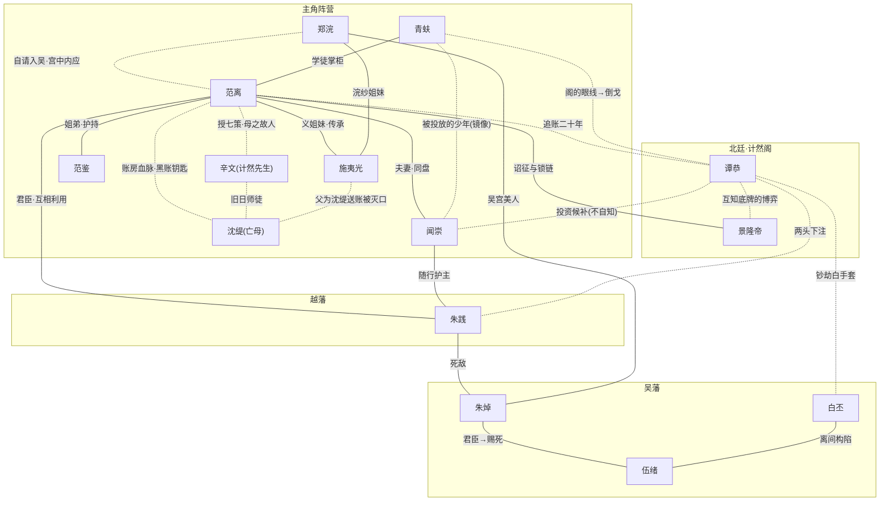

# 《陶朱娘子》人物图谱与时空线

> 📖 教学注释:这是全书的"地图与挂钟"。写正文前对三样:关系演变(人物关系崩没崩)、时间轴(年龄穿帮没)、地点线(场景漂移没)。03 逐章大纲的「时间」「地点」两列必须与本文件一致。

## 人物关系图谱
> 📖 教学注释:总图谱按阵营分组(subgraph),比 01 的核心关系图更全:所有重要人物都挂进阵营;实线=明面关系,虚线=隐藏关系,连线标注"关系性质"。节点 id 纯 ASCII,中文放双引号标签。

### 总图谱(按阵营分组)

### 阵营说明
| 阵营 | 成员 | 立场 | 备注 |
| --- | --- | --- | --- |
| 主角阵营 | 范离、闻崇、施夷光、范鉴、辛文、郑浣(吴宫内应)、青蚨(策反执事) | 翻案与终结阁道 | 沈缇遗志继承者 |
| 越藩 | 朱践 | 战败弱藩→枭雄 | 勾践原型,亦主亦险 |
| 吴藩 | 朱焯、伍绪、白丕 | 强藩 | 夫差线,伍绪为镜像忠臣 |
| 北廷·计然阁 | 景隆帝、谭恭 | 收网者与幕后棋手 | 谭恭兼当代计然阁主 |

### 关系演变表
| 关系 | 起点状态(章节) | 转折事件(章节) | 终点状态(章节) |
| --- | --- | --- | --- |
| 范离↔闻崇 | 公堂识破、互相试探(3-4) | 留越之诺(14)/旧信疑云(57)/同盘之诺(59)/国债赎命(88) | 泛舟同去,双向奔赴(99) |
| 范离↔朱践 | 长颈鸟喙之惧(13) | 孤注入局(19)/良娣之旨(65)/兔死狗烹(74) | 越营摊牌,退兵互懂(92-93) |
| 范离↔谭恭 | 朱笔圈名(21) | 鹤顶红警告(31)/屏风对谈(64) | 黑账惊天下,赐死(72-73) |
| 闻崇↔谭恭 | 无名贺信(49) | 候补身份揭盅(58) | 砸玉佩决裂(69) |
| 范离↔施夷光 | 救于贡女局(27-28) | 冒火抢档(62) | 拜师接棒,执掌商盟(79/100) |
| 范离↔范鉴 | 立家规护持(16) | 赌债屡犯(45) | 救弟三散,知账之重(81-86/98) |
| 范离↔辛文 | 卖卦识破(34) | 授七策(36) | 密库同谋,焚名录同证(68/97) |
| 朱焯↔伍绪 | 死谏(41) | 下狱(55) | 赐死,"无面目见"(56/63) |
| 闻崇↔朱践 | 谢恩折暗语(13) | 外放支开(65) | 夜闯安人府同退(75) |
| 范离↔郑浣 | 贡女册另一名(27) | 自请顶替入吴,宫中策应(62) | 城破开门护民,功成归商(63/79) |
| 青蚨↔范离 | 入店眼线(29) | 动摇未报(39)→倒戈递证(58) | 密库同谋(68),平准行执事(100) |
| 青蚨↔谭恭 | 投放监视(29) | 密报中断(39) | 倒戈决裂(58) |

## 时间线
> 📖 教学注释:纪年体系定稿后不再改;主角年龄是硬约束,逐章「时间」列从这里取值。

### 纪年体系
| 纪年 | 说明 | 备注 |
| --- | --- | --- |
| 承平 | 先帝年号 | 宝钞黑账《承平钞档》所记年代 |
| 景隆 | 今上年号,全书主纪年 | 六年春开篇,二十年春泛舟 |

### 主线时间轴
| 阶段/卷 | 故事内时间跨度 | 范离年龄 | 关键事件 | 对应章节 |
| --- | --- | --- | --- | --- |
| 卷一 宛陵藏珠 | 景隆六年春—八年秋 | 16→19 | 穿越护产、翻案、入局、北上为质 | 1-25 |
| 卷二 质邸三年 | 八年冬—十二年 | 19→23 | 为质、七策、归国掌度支、生聚开局 | 26-50 |
| 卷三 经纬吞吴 | 十二年冬—十五年 | 23→26 | 倒钞粮战灭吴、黑账摊牌、兔死狗烹 | 51-75 |
| 卷四 泛舟五湖 | 十五年—十九年(尾声至多年后) | 26→30 | 退隐创业、救弟救国、三散泛舟 | 76-100 |

### 人物年龄对表
| 人物 | 卷一 | 卷二 | 卷三 | 卷四 | 备注 |
| --- | --- | --- | --- | --- | --- |
| 范离 | 16-19 | 19-23 | 23-26 | 26-30 | 穿越附身原主十六岁 |
| 闻崇 | 19-22 | 22-26 | 26-29 | 29-33 | 长范离三岁 |
| 朱践 | 30-33 | 33-37 | 37-40 | 40-44 | 长范离十四岁 |
| 施夷光 | 15-18 | 18-22 | 22-25 | 25-29 | 小范离一岁 |
| 范鉴 | 10-13 | 13-17 | 17-20 | 20-24 | 小范离六岁,卷四闯祸 |
| 郑浣 | 15-18 | 18-22 | 22-25 | 25-29 | 与施夷光同庚,浣纱双姝 |
| 青蚨 | 13-16 | 16-20 | 20-23 | 23-27 | 小范离三岁,阁养的孤儿 |

## 地点线
> 📖 教学注释:地点线管"人在哪、路怎么走"。人物迁徙必须连续(上一站→下一站有路径),防瞬移穿帮;03 逐章「地点」列从这里取值。

### 地理格局总览
| 地点 | 归属 | 与主线关系 |
| --- | --- | --- |
| 宛陵 | 越地商埠 | 范家所在,卷一主场景,83章一散家财 |
| 山阴 | 越藩都城 | 归国后卷二后半与卷三主场景 |
| 金陵 | 吴藩都城→灭吴后监国驻节 | 质邸三年、灭吴摊牌、终局 |
| 京师 | 北廷 | 密库取档、救弟救国 |
| 陶丘 | 齐地 | 卷四退隐二次创业 |
| 吴地 | 吴藩腹地 | 倒钞粮战主战场 |
| 运河 | 漕运线 | 北上为质、散财船 |
| 五湖 | 江湖 | 泛舟终局 |
| 北疆 | 边关 | 北狄之役 |

### 逐卷主要场景
| 卷 | 主要地点 | 关键场景 | 对应章节 |
| --- | --- | --- | --- |
| 卷一 | 宛陵 | 灵堂、公堂、账房、织坊 | 1-18 |
| 卷一 | 山阴 | 越王府、平粜局、城下之盟 | 19-23 |
| 卷一 | 运河—金陵 | 密账房、质邸 | 24-25 |
| 卷二 | 金陵 | 质邸、资舟号分号、白府寿宴、天牢 | 26-43 |
| 卷二 | 山阴 | 度支司、盐引局、常平仓 | 44-50 |
| 卷三 | 山阴—吴地—金陵 | 三箭总攻、围城、码头宣读 | 51-67 |
| 卷三 | 京师 | 计然阁密库 | 68-69 |
| 卷三 | 金陵 | 安人府 | 70-75 |
| 卷四 | 金陵—陶丘—宛陵 | 遁走、二次创业、一散 | 76-83 |
| 卷四 | 京师 | 朝堂谈判、北狄之役 | 84-95 |
| 卷四 | 金陵—五湖 | 三散、焚库、泛舟 | 96-100 |

### 人物迁徙路线
| 人物 | 迁徙路线(按时间序) | 对应章节 |
| --- | --- | --- |
| 范离 | 宛陵→(运河)→金陵→(归国)→山阴→(灭吴)→金陵→(京师行)→京师→金陵(安人府)→(遁走)→陶丘→宛陵(一散)→京师→金陵→五湖 | 1-100 |
| 闻崇 | 京师(御史)→宛陵(巡按)→山阴(推官)→金陵(质邸属官)→山阴(左长史)→金陵→京师→陶丘→京师(被留)→金陵→五湖 | 3-100 |
| 施夷光 | 若耶溪→金陵(质邸)→金陵商界→陶丘→金陵(商盟执读) | 27-100 |
| 郑浣 | 若耶溪→吴宫(金陵)→(城破)→金陵商界 | 27-79 |
| 青蚨 | 京师(阁)→金陵(资舟号)→京师(密库接应)→金陵(平准行) | 29-100 |

### 可复用场景清单
| 场景 | 关联地点/人物 | 已用章节 |
| --- | --- | --- |
| 资舟号账房 | 范离、闻崇 | 8/11/29/45/73 |
| 质邸大堂 | 朱践、朱焯 | 26/43 |
| 白府寿宴 | 白丕、范离 | 40 |
| 司礼监值房 | 谭恭 | 21/38/73 |
| 安人府 | 朱践、范离 | 74-75 |
| 平准行总行 | 范离、施夷光 | 79/97-98 |
| 吴宫内苑 | 郑浣、朱焯 | 40/62-63 |
