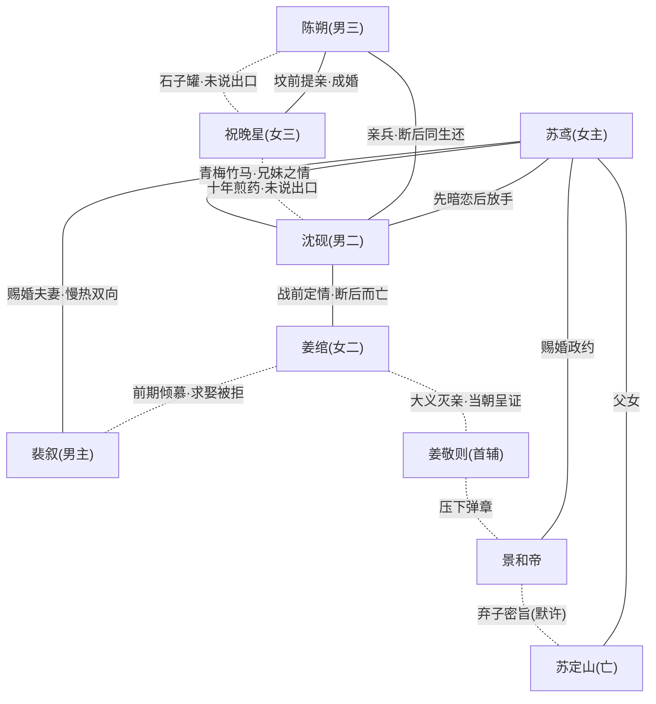

# 《鸢尾来信》灵感与设定

> 📖 教学注释:这是全书的"户口本"。写正文卡住时回来对三样:一句话简介(没写偏没偏)、人物小传(人设崩没崩)、世界观(设定打架没)。

## 一句话简介
罪臣孤女借联姻查父案,错位人心各归其位。

## 简介(约 200 字)
北疆白狼原一战,苏老将军"战死",圣旨转头就把苏家孤女苏鸢赐给了新贵裴叙——谁都知道,这是一桩政治婚姻。裴叙娶她只为朝局安稳,苏鸢嫁他只为查父死真相;青梅竹马的沈砚转身从军,满京骄女姜绾恨她夺其所爱,煎了十年药的祝晚星沉默看着沈砚的背影。直到军情泄露的线头被一一抽出:父帅不是战死,是被自己人卖了;那个不可一世的郡主,是唯一敢大义灭亲的人;而追了一辈子背影的沈砚,原来早就被一个人看见了。断线的纸鸢终会落地——落在谁手里,天知道。

## 题材标签
古言架空 / 权谋战争 / 错位群像 / 慢热双向 / 男二意难平(主CP HE)

## 爽点与看点清单
| 爽点 | 说明 | 密度 |
| --- | --- | --- |
| 赐婚政斗 | 罪臣孤女嫁新贵,满京算计与暗流 | 卷一集中 |
| 推图救夫 | 女主以舆图推演刺客撤线救男主 | 卷一 |
| 查案证据链 | 验尸卷宗→缺页军报→商队路引,层层抽出 | 贯穿 |
| 女二大义灭亲 | 郡主当朝掀翻自家,全书高光 | 卷三 |
| 战争群像 | 青川渡断后三日,军人史诗 | 卷三高潮 |
| 遗书告白 | 信比人慢的意难平,全书泪峰 | 卷四 |
| 男三提亲 | 坟前求点头,虐后最甜 | 卷四 |
| 昭雪立祠 | 迟到十年的公道与香火 | 卷四 |
| 女女和解 | 情敌在山河面前成同袍 | 卷二末 |
| 纸鸢闭环 | 断线纸鸢终有人接住 | 尾声 |

## 世界观
### 时代与背景
架空王朝"大昭",景和年间,先帝元徽末年北漠坐大。战和之争二十年:主战将门(裴、苏、沈)与主和后族(太后姜氏、首辅姜敬则)拉锯。景和三年白狼原之败,苏定山"战死",赐婚压丧——全书自这场败仗的余波里展开。
### 地理格局
京师(帝都:裴府、苏府、郡主府、皇宫与兵部)/ 北疆(朔风关、白狼原、青川渡与碑亭、二公祠)/ 榷场(边境互市,通敌渠道)/ 北漠王庭(虚写)/ 运河—北疆驿道/ 屯田与随军医营。
### 势力与组织
| 势力 | 立场 | 实力 | 关键人物 |
| --- | --- | --- | --- |
| 主和派(姜氏) | 以和养敌 | 太后+首辅,把持朝议与商路 | 姜敬则、姜承业、太后姜氏 |
| 主战将门 | 裴、苏、沈三家 | 军心所系,朝中势弱 | 裴叙、苏定山、沈毅 |
| 北漠 | 外敌 | 铁骑,窥探军情 | 王庭(虚写) |
| 祝家 | 北疆军医 | 验尸与药案卷宗 | 祝伯言、祝晚星 |
| 朝廷 | 制衡战和两派 | 名义共主 | 景和帝 |
### 规则体系
无超自然。制度规矩:赐婚政约、郡主册封、兵部职方司军报驿传、互市路引、火漆印信、军医验尸造册。暗线规则:军情泄露代号"青盖"——北漠与京中内应密信的落款。关键道具:纸鸢、平安符、火漆印"绾"、《白狼原验尸录》、苏定山密奏抄存、姜氏账册副本、"青盖"密信、缺页军报、弃子手令残片、石子罐、药方底稿、未寄信、遗书、悔诏。
### 核心矛盾与主题
战与和(国策)×爱与错位(人心)。主题句:爱,是终于被人看见——全书每个人物都卡在"看见"或"被看见"的一道坎上。

## 人物小传
> 📖 教学注释:四件套 = 欲望/恐惧/秘密/弧线;"暗线身份"列写他真正在棋盘上的位置。每写一场戏,问一遍:在场每个人分别被什么推着、拦着?
复杂度基线核对:双重身份 ≥3 组(裴叙将门/帝之棋,姜绾郡主/通敌渠道挂牌人,沈砚骁将/知情隐忍者,祝晚星医女/卷宗持有人);隐藏关系 ≥3 组(姜绾-姜敬则祖孙通敌、姜承业-北漠商队夹带、苏定山-祝伯言密奏抄存、祝晚星-沈砚十年单恋、陈朔-祝晚星石子罐);镜像人物 ≥2 组(沈砚vs陈朔"追与守"、姜绾vs祝晚星"慕强与守夜"、裴叙vs景和帝"执棋人与棋盘");血缘暗雷 ≥1 组(姜绾身上流着通敌姜家的血,大义灭亲必见血);反派分层:姜承业(白手套)→姜敬则(幕后主谋)→景和帝(弃子默许的制度之恶)。

| 姓名 | 明面身份 | 暗线身份 | 欲望 | 恐惧 | 秘密 | 弧线一句话 |
| --- | --- | --- | --- | --- | --- | --- |
| 苏鸢 | 女主:苏定山之女→罪臣孤女→裴叙之妻→北疆同行者;自幼随父戍边,通军报舆图 | 父案推演者:祝家卷宗+舆图推演,暗线民间半边主脑 | 查清父死真相,守住苏家门楣 | 真相永远埋在白狼原 | 母亲遗下的半幅北疆舆图(父亲手绘) | 孤女→侯夫人→执图者→北疆同行者 |
| 裴叙 | 男主:镇北侯世子→侯爷→大军主帅;寡言慢热 | 皇帝平衡将门的"棋",后成执棋人;层3知情封存者 | 打赢北漠,护住活人 | 成为帝权的刀再被折断 | 封存的弃子密旨残片(F14);幼年为质的寒毒旧疾 | 冷面棋子→被看见→执棋人→守护者 |
| 沈砚 | 男二:苏家世交沈毅之子,与苏鸢青梅竹马;边军小将→骁将 | 父遗信"箭来自身后"的知情隐忍者(怕动摇军心牵连苏家) | 为父雪冤;追上那个背影(未遂) | 真相牵连苏家;全军再败 | 未寄出的第一封信(F10) | 追背影的人→被看见的人→断后而死,信至人亡 |
| 姜绾 | 女二:永嘉郡主,太后侄孙女,京中骄女 | 通敌渠道"嫁妆商队"的挂牌人(不自知→自知),大义灭亲者 | 嫁给天下最优者(前期=裴叙) | 高门联姻之外的错位;家族倾覆 | 求娶裴叙被拒(F15);商队账册副本(F08) | 骄女→慕强→被看见→大义灭亲→替两个人看山河 |
| 祝晚星 | 女三:军医祝伯言之女,随军医女 | 《白狼原验尸录》与父亲抄存密奏的持有人(F01/F11) | 让沈砚看她一眼 | 自己永远是"背景" | 三年改的药方底稿(F12);青川渡之夜她握着沈砚最后的心跳 | 守望→随军→未救回之痛→在陈朔的恒久里学会被爱 |
| 陈朔 | 男三:沈砚亲兵斥候→百户→北疆屯田百户 | 遗书与遗物的护送者;军中"活档案" | 让祝晚星回头看一眼 | 她的眼睛永远越过他 | 攒了一罐边关小石子(F13);断后夜背回遗体与信 | 沉默亲兵→断后同生还→守灵守人→提亲成婚 |
| 姜敬则 | 内阁首辅,主和派领袖,姜绾祖父 | 通敌主谋"青盖":卖军情换和谈筹码与姜氏权位 | 保姜氏百年煊赫 | 主战得势=姜氏倾覆 | 与北漠往来的"青盖"密信 | 权相→纸牌屋被孙女亲手抽掉 |
| 姜承业 | 姜绾之兄,兵部职方司郎中 | 泄密执行人:军报缺页、商队夹带 | 爵位仕途 | 被祖父当弃子 | 职方司档案涂改手迹 | 世家子弟→白手套→案发被弃车保帅 |
| 景和帝 | 天子,年号景和 | 层3:知情默许弃子(用苏定山死换和谈窗口) | 江山与储位安稳 | 北漠倾国;将门坐大 | 弃子密旨残片(F14) | 制衡帝王→错算→被迫下悔诏昭雪 |
| 苏定山 | 女主之父,北疆大将(亡) | "弃子";死前察觉军情泄露,密奏被扣 | 打赢这一仗 | 军心崩、苏家清算 | 死前密奏(祝伯言抄存,F11) | 老将→察觉→赴死→追谥昭雪 |
| 沈毅 | 男二之父,沈家军旧帅(亡) | 同战死;死前察觉"箭来自身后",遗信警示 | 护住沈家军火种 | 儿子卷入朝局 | 遗信"箭来自身后" | 老将→察觉→战死→遗信引儿子入局 |
| 祝伯言 | 女三之父,北疆军医官 | 白狼原亲历者:验尸记录+抄存密奏,装聋作哑保命 | 医者本分与真相之间 | 祸从笔出 | 《白狼原验尸录》全本 | 隐忍医官→卷宗交出→真相落地 |
| 太后姜氏 | 太后,姜氏靠山 | 知情纵容弟弟通敌 | 姜氏不倒 | 皇帝亲政清算 | 多次压下弹章 | 后族靠山→大厦倾→幽居 |

## 人物关系图
> 📖 教学注释:实线=明面关系,虚线=隐藏关系。关系变了回来改图,防"关系漂移"。

