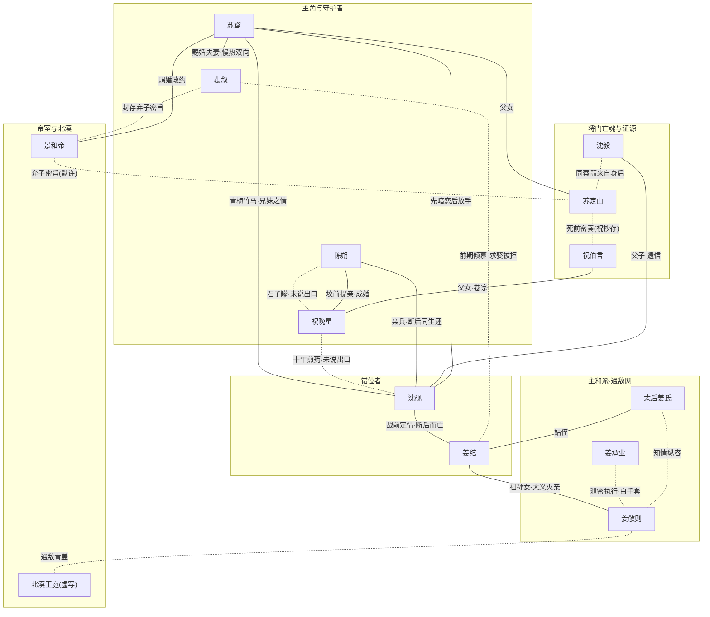

# 《鸢尾来信》人物图谱与时空线

> 📖 教学注释:这是全书的"地图与挂钟"。写正文前对三样:关系演变(人物关系崩没崩)、时间轴(年龄穿帮没)、地点线(场景漂移没)。03 逐章大纲的「时间」「地点」两列必须与本文件一致。

## 人物关系图谱
> 📖 教学注释:总图谱按阵营分组(subgraph),比 01 的核心关系图更全:所有重要人物都挂进阵营;实线=明面关系,虚线=隐藏关系,连线标注"关系性质"。节点 id 纯 ASCII,中文放双引号标签。

### 总图谱(按阵营分组)

### 阵营说明
| 阵营 | 成员 | 立场 | 备注 |
| --- | --- | --- | --- |
| 主角与守护者 | 苏鸢、裴叙、祝晚星、陈朔 | 查案·守护·守望得偿 | 主CP与圆满副CP |
| 错位者 | 沈砚、姜绾 | 彼此看见,阴阳相隔 | 全书泪点承载 |
| 将门亡魂与证源 | 苏定山、沈毅、祝伯言 | 暗线证源 | 白狼原三人组 |
| 主和派·通敌网 | 姜敬则、姜承业、太后姜氏 | 以和养敌 | 反派分层 |
| 帝室与北漠 | 景和帝、北漠王庭(虚写) | 弃子逻辑与外敌 | 层3与战场 |

### 关系演变表
| 关系 | 起点状态(章节) | 转折事件(章节) | 终点状态(章节) |
| --- | --- | --- | --- |
| 苏鸢↔裴叙 | 赐婚如朝会(4) | 推图救夫(13)/契约靠近(44)/吃醋确认(45) | 重走父路,"换我看你"(99) |
| 沈砚↔苏鸢 | 青梅竹马(1-11) | 放手第一课(15) | 兄长如故(45),未寄信焚坟(85) |
| 姜绾↔沈砚 | 被扣与雪路(23-26) | 你敢给我就敢接(42)/赠印定情(54) | 断后战死(63),遗书至(81),坟前回信(82) |
| 姜绾↔裴叙 | 前期倾慕(2-3) | 求娶被拒(2)/宫宴拒白(16) | 断念北去(17),山河同袍(49/51) |
| 祝晚星↔沈砚 | 十年煎药(29) | 点破(46) | 未救回之痛(65/68),坟前长揖释怀(83) |
| 祝晚星↔陈朔 | 石子罐(30) | 帐外三夜(68) | 石子告白(84),坟前提亲(89),大婚(94) |
| 姜绾↔姜敬则 | 祖孙(9) | 发现账册(40-41) | 大义灭亲(51),决裂终(78) |
| 陈朔↔沈砚 | 亲兵(24) | 断后同生还(62-65) | 送信(76),守碑传给下一代(95-96) |
| 景和帝↔裴叙 | 帝的棋(8) | 压案(32)/弃子(59-63) | 君臣心照(88),悔诏(93) |
| 苏鸢↔姜绾 | 拦轿恨(3) | 女女和解(49) | 同祭(83/92),鸢尾花(100) |

## 时间线
> 📖 教学注释:纪年体系定稿后不再改;主角年龄是硬约束,逐章「时间」列从这里取值。

### 纪年体系
| 纪年 | 说明 | 备注 |
| --- | --- | --- |
| 景和 | 今上年号,全书主纪年 | 三年春开篇,十七年夏终章 |
| 元徽 | 先帝年号 | 白狼原旧账所记年代 |

### 主线时间轴
| 阶段/卷 | 故事内时间跨度 | 苏鸢/裴叙年龄 | 关键事件 | 对应章节 |
| --- | --- | --- | --- | --- |
| 卷一 赐婚 | 景和三年春—五年春 | 18→20 / 22→24 | 败讯赐婚·大婚查案·救使 | 1-25 |
| 卷二 边声 | 五年春—六年冬 | 20→22 / 24→26 | 三线同营·层1揭盅·女二献副本 | 26-50 |
| 卷三 烽火 | 七年春—七年冬 | 23 / 27 | 呈证·点将·大战·断后战死 | 51-75 |
| 卷四 寄信 | 七年冬—十一年(尾声至景和十七年) | 24→28 / 28→32 | 遗书·昭雪·提亲·尾声 | 76-100 |

### 人物年龄对表
| 人物 | 卷一 | 卷二 | 卷三 | 卷四 | 备注 |
| --- | --- | --- | --- | --- | --- |
| 苏鸢 | 18-20 | 20-22 | 23 | 24-28(尾声33+) | 大婚时十八 |
| 裴叙 | 22-24 | 24-26 | 27 | 28-32(尾声37+) | 长苏鸢四岁 |
| 沈砚 | 19-21 | 21-23 | 24(殁) | — | 长苏鸢一岁,景和七年秋战死 |
| 姜绾 | 19-21 | 21-23 | 24-25 | 25-29(尾声34+) | 长苏鸢一岁 |
| 祝晚星 | 16-18 | 18-20 | 21 | 22-26(尾声31+) | 小苏鸢两岁 |
| 陈朔 | 19-21 | 21-23 | 24 | 25-29(尾声34+) | 长苏鸢一岁,沈砚亲兵 |

## 地点线
> 📖 教学注释:地点线管"人在哪、路怎么走"。人物迁徙必须连续(上一站→下一站有路径),防瞬移穿帮;03 逐章「地点」列从这里取值。

### 地理格局总览
| 地点 | 归属 | 与主线关系 |
| --- | --- | --- |
| 京师 | 大昭帝都 | 裴府/苏府/郡主府/皇宫/兵部,卷一卷二主场景 |
| 朔风关 | 北疆重镇 | 沈家驻地,男二军营与女三医营 |
| 白狼原 | 北疆 | 苏定山战死地,卷三再战地,二公祠所在 |
| 青川渡 | 北疆 | 沈砚断后战死地,石垒坟与碑亭 |
| 榷场 | 边境互市 | 女二被扣地,通敌渠道 |
| 北漠王庭 | 北漠(虚写) | 密约另一端,层3外证来源 |
| 运河—北疆驿道 | 南北命脉 | 使团北去、遗书南来 |
| 屯田 | 北疆 | 女二辞封后戍所 |
| 随军医营 | 北疆 | 祝晚星所在 |

### 逐卷主要场景
| 卷 | 主要地点 | 关键场景 | 对应章节 |
| --- | --- | --- | --- |
| 卷一 | 京师 | 苏府灵堂、皇宫、裴府、长街、赏梅宴 | 1-11 |
| 卷一 | 京师 | 巷中遇刺、兵部档房、郡主府 | 12-21 |
| 卷一 | 榷场—北漠边墙 | 互市、扣使、雪夜袭营 | 22-25 |
| 卷二 | 朔风关 | 边军营、医营、榷场残档 | 26-31 |
| 卷二 | 京师 | 兵部、裴府灯下、皇宫 | 32-35 |
| 卷二 | 边墙外—榷场 | 信使、账册 | 36-41 |
| 卷二 | 朔风关—京师 | 托付、契约、点破、全链 | 42-50 |
| 卷三 | 皇宫—京师 | 当朝呈证、抄检 | 51-52 |
| 卷三 | 北疆大营—白狼原 | 点将、定情、再战、诱敌 | 53-57 |
| 卷三 | 北漠腹地—青川渡 | 中伏、撤军、断后三日、战死 | 58-64 |
| 卷三 | 南岸医营—北疆 | 医营之夜、举丧、灵前、收殓、手令 | 65-71 |
| 卷四 | 驿道—京师 | 送信、王庭档、辞封 | 76-78 |
| 卷四 | 北疆屯田—青川渡 | 信至、遗书全文、坟前回信、两女坟前 | 79-83 |
| 卷四 | 医营—北疆 | 石子告白、未寄信、药方、层3、君臣 | 84-88 |
| 卷四 | 青川渡—医营 | 提亲、答案 | 89-90 |
| 卷四 | 京师—白狼原 | 五证并呈、二公祠、悔诏、大婚 | 91-94 |
| 卷四 | 碑亭—各地 | 守岁、尾声四折 | 95-100 |

### 人物迁徙路线
| 人物 | 迁徙路线(按时间序) | 对应章节 |
| --- | --- | --- |
| 苏鸢 | 京师苏府→裴府→(随军)北疆大营→白狼原→京师→北疆(镇守)→(尾声)重走父路 | 1-100 |
| 裴叙 | 京师→北疆→京师→北疆(挂帅→镇守)→帝巡→尾声 | 1-100 |
| 沈砚 | 朔风关→京师(述职)→朔风关→榷场(救使)→北漠边墙→青川渡(殁) | 10-63 |
| 姜绾 | 京师郡主府→榷场(被扣)→朔风关(养伤)→京师(献证辞封)→北疆屯田→(尾声)山河行走 | 3-100 |
| 祝晚星 | 北疆医营(朔风关)→白狼原→青川渡→朔风关医堂 | 29-100 |
| 陈朔 | 朔风关→北漠边墙→青川渡(重伤)→驿道(送信)→北疆→朔风关(婚)→碑亭(守岁)→屯官 | 24-100 |

### 可复用场景清单
| 场景 | 关联地点/人物 | 已用章节 |
| --- | --- | --- |
| 裴府灯下 | 苏鸢、裴叙 | 6/14/35/44/48 |
| 医营帐内 | 祝晚星、陈朔 | 29/65/68/84/86 |
| 朔风关校场 | 沈砚、陈朔、姜绾 | 10/24/27/42 |
| 青川渡石垒·碑亭 | 沈砚、姜绾、陈朔一家 | 61-64/82-83/95-98 |
| 皇宫大殿 | 姜绾、姜敬则、裴叙 | 2/8/16/51/88 |
